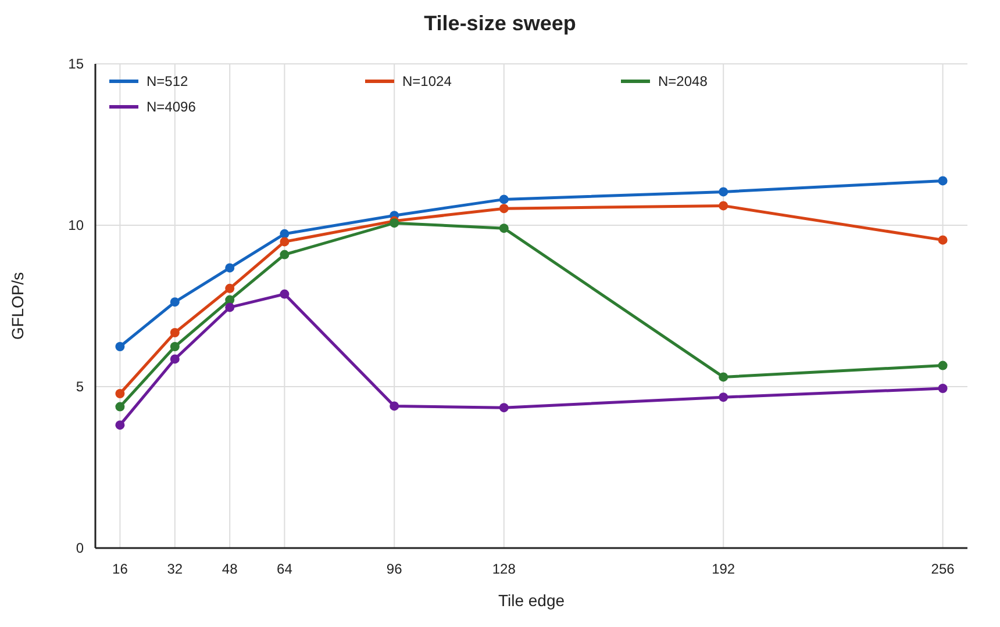
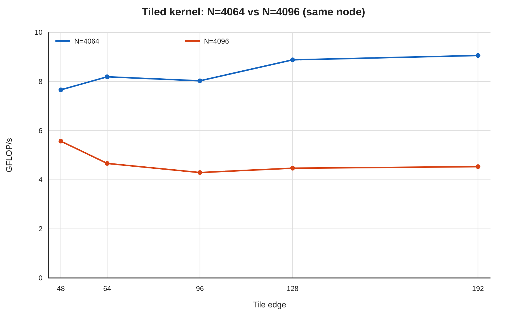
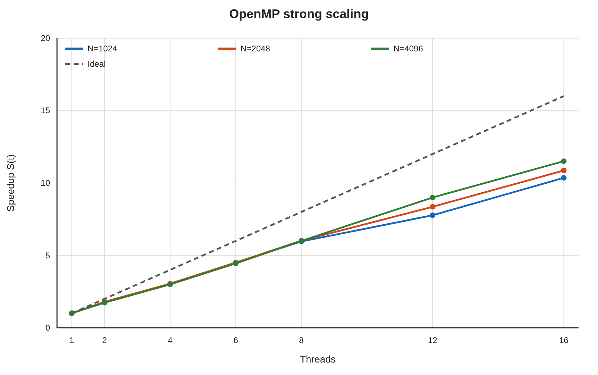
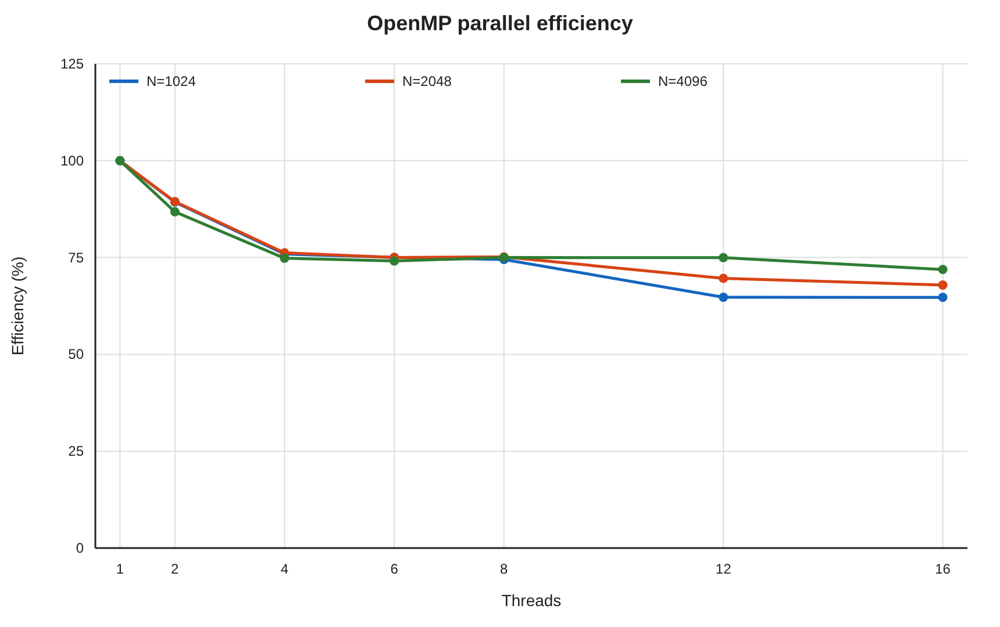
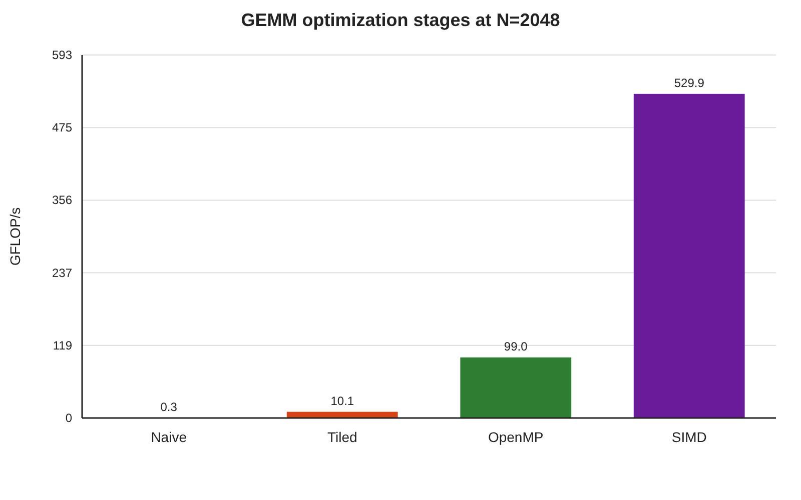
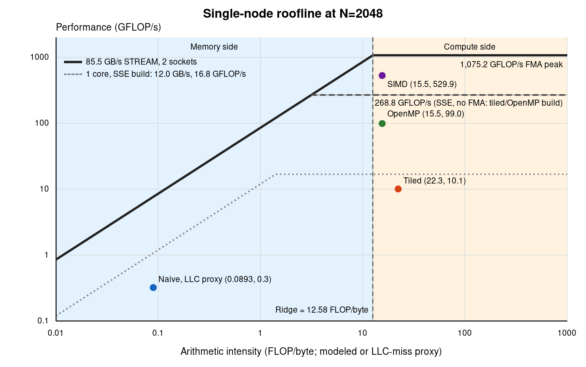
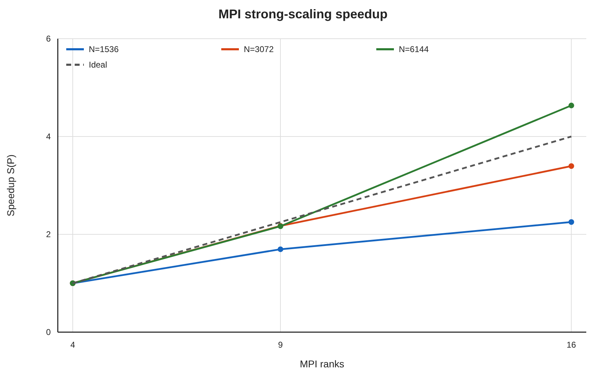
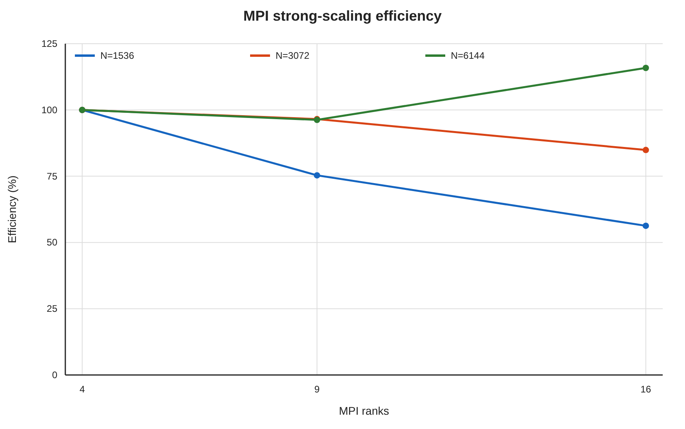
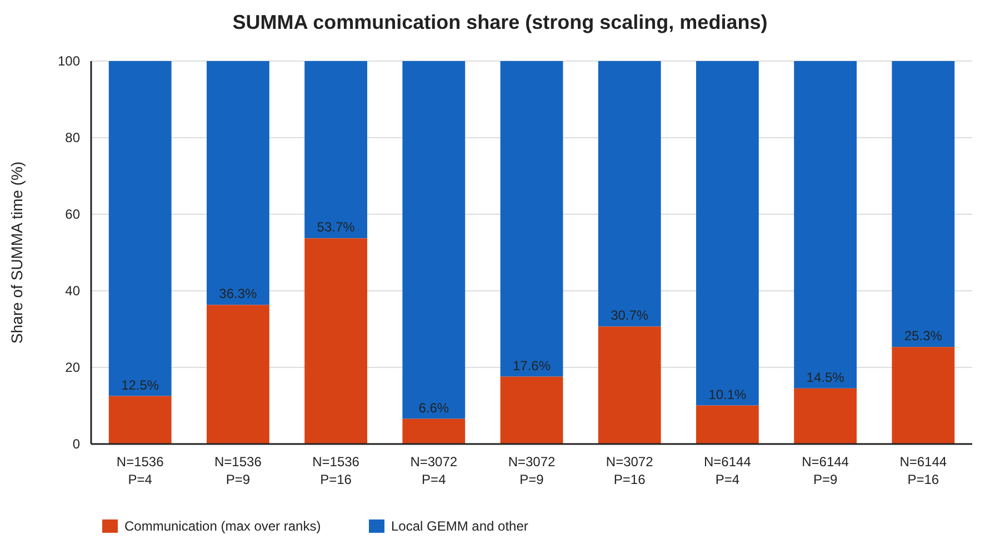
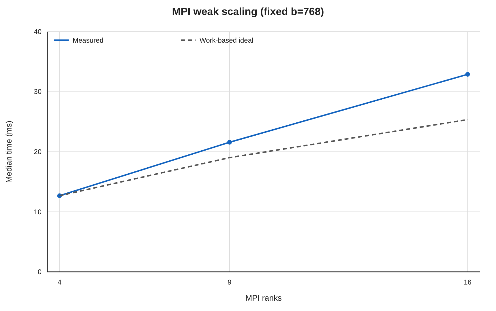

# Midterm Project - Performance Engineering of GEMM

**Name:** Harsha Vardhan Puvvadi  
**Measurement system:** NCSU ARC, Intel Xeon Silver 4110 nodes

## Abstract

This report develops dense single-precision matrix multiplication from the provided `ijk` baseline into tiled, OpenMP, AVX2, and distributed MPI+OpenMP implementations. Every submitted kernel preserves the required `C += A*B` operation, and all explicit correctness tests passed. On one 16-core Intel Xeon Silver 4110 node, loop reordering raised performance at `N=2048` from 0.321 to 6.204 GFLOP/s, blocking raised it to 10.067 GFLOP/s, OpenMP reached 99.039 GFLOP/s, and AVX2 reached 529.861 GFLOP/s. The best SIMD median was 649.0 GFLOP/s at `N=512`, or 60.4% of the node's nominal 1.075 TFLOP/s base-clock FP32 ceiling. Power-of-two row strides caused cache-set conflicts that cost the SIMD kernel up to 1.75x, while OpenMP reached 71.9% efficiency on 16 threads with a 2.6% effective serial fraction. STREAM Triad measured 85.5 GB/s. Stationary-C SUMMA reached 1.80 TFLOP/s on 16 ranks. From 4 to 16 ranks, strong-scaling efficiency was 56.3% at `N=1536`, 84.9% at `N=3072`, and 115.9% at `N=6144`. Communication reached 53.7% of runtime for the smallest problem. Weak-scaling efficiency at fixed block size was 77.1% at 16 ranks.

## 1. Methods and implementation

### Hardware and measurement procedure

The primary single-node measurements ran on ARC node **`c26`**, which contains two Intel Xeon Silver 4110 sockets: 16 physical cores and 32 logical CPUs with two hardware threads per core. Slurm allocated 16 CPUs. Each core has a 32 KiB L1 data cache and 1 MiB L2, each socket has 11 MiB L3. The node has two NUMA domains. The environment used GCC 12.4.0, Open MPI 4.1.6, `OMP_PLACES=cores`, `OMP_PROC_BIND=close`, and `OMP_DYNAMIC=false`. [ARC hardware description](https://arcm.csc.ncsu.edu/~mueller/cluster/arc/).

The single-node experiments tested `N=512,1024,2048,4096`, tile sizes `16,32,48,64,96,128,192,256`, and thread counts `1,2,4,6,8,12,16`. Each non-naive performance case has five independent repetitions, while the slower naive baseline has three. I report the median GFLOP/s. Every timed run, single node and MPI, used `--iters=1`: the harness makes one untimed call and then times one call, instead of its default policy of repeating until about 2 s have elapsed (capped at 100 calls). The fastest single-node runs therefore time a single call of a few milliseconds, which adds run-to-run noise. Section 10 quantifies it.

The final MPI measurements ran on Xeon Silver 4110 nodes with SMT disabled: **`c12`–`c13`** for `P=4`, **`c14`–`c16`** for `P=9`, and **`c12`–`c15`** for `P=16`. These configurations use 2, 3, and 4 nodes, respectively, with one row of the square MPI process grid placed on each node. ARC's `prun` launches the ranks, and Open MPI assigns each rank four dedicated physical cores using `ppr:p:node:PE=4` with core binding. Each rank then runs four OpenMP threads, pinned within those cores by `OMP_PLACES=cores` and `OMP_PROC_BIND=close`. Before timing, an MPI+OpenMP affinity probe verifies that the thread CPU masks do not overlap within or across ranks on the same node. This placement keeps row broadcasts within a node while column broadcasts cross the network. Every timed configuration has five repetitions.

**Node roles.** Node **`c26`** supplies the primary single-node performance tables, scaling results, STREAM ceiling, and roofline. Node **`c17`** appears only in explicitly labelled supplementary cache-stride and counter controls. Its timings are not substituted into the primary single-node results. The MPI experiments use the separately listed multi-node allocations above.

The IKJ comparison kernel and the three submitted single-node kernels passed the supplied checks at `N=160`. IKJ, tiled, and OpenMP produced zero relative error. SIMD produced relative error $2.317\times10^{-7}$, well below the $10^{-4}$ tolerance and consistent with FMA rounding. Each MPI configuration ran checked `N=384` (tile 48) and `N=1536` (tile 64) SUMMA cases before its sweep, all six passed, with relative error $\le 7.3\times10^{-7}$. Additional tests checked the tiled, OpenMP, and SIMD kernels at `N=512` and `N=1024`, including non-dividing tiles of 48 and 30 that exercise the SIMD cleanup paths, all twelve passed. The naive kernel also produced exact results at both sizes. All timed runs used `--no-check`.

### Single-node code design

The tiled kernel uses block order `bi,bj,bk` and element order `i,k,j`. Putting `j` innermost makes the loop read B and write C along rows, which are contiguous in row-major storage, while `A[i][k]` stays in a register for the whole row segment. In `ijk` order the inner loop instead walks a column of B with stride N and touches a new cache line on every iteration. Tiling bounds the working set: one tile each of A, B, and C at b = 64 is $3\times64^2\times4$ B = 48 KiB, which exceeds the 32 KiB L1 but fits easily in the 1 MiB L2. Each block end is clamped with `min(b+offset,n)`, so the code handles an N that is not divisible by the requested tile. In all three kernels `--tile` is the edge of the i, j, and k blocks alike.

The OpenMP kernel divides work by C tile, collapsing the `bi` and `bj` loops. A thread owns one output tile across the complete `bk` loop, so no two threads update the same C element and no atomic operation or reduction is required. Parallelizing `bk` instead would make threads accumulate into the same output tile and require synchronization or private reductions. The two tile loops are collapsed because either one alone has too little parallelism: at `N=512` and tile 64 there are only 8 values of `bi` for 16 threads, while the collapsed loop has 64 tiles. Tiles are assigned with `schedule(dynamic)`, so a thread that finishes early takes the next unclaimed tile.

The SIMD kernel uses a 4-row by 16-column AVX2 micro-kernel, and its shape follows from two hardware limits. The first is latency: an FMA takes 4 cycles and the core can start two per cycle, so eight independent FMAs must be in flight to keep both units busy, whereas a single accumulator would serialize every FMA on the previous result. A 4x16 block of C provides exactly eight `__m256` accumulators, which hold 64 C elements across the k loop. Together with two B vectors and one A broadcast they occupy 11 of the 16 ymm registers, so nothing spills. The second is load bandwidth: the core issues two loads per cycle, so sustaining two FMAs per cycle allows at most one load per FMA. At each k the kernel loads two contiguous vectors from B, broadcasts four A values, and issues eight FMAs, which is 0.75 loads per FMA. A 1x8 kernel needs two loads per FMA and cannot approach peak even with perfect latency hiding. A is broadcast and B is vector-loaded because the row segment `B[k][j..j+15]` is contiguous, and C is loaded and stored only once per k block rather than inside the innermost loop. B is not packed into a contiguous buffer. At power-of-two N its rows lie at a 4 KiB stride and map to the same cache sets, which Section 5 measures as a cost of up to 1.75x.

A 1x8 vector path and a scalar path handle partial tiles, although the measured tile 64 and problem sizes divide evenly into the 4x16 kernel. The cleanup paths are written for correctness, not speed: the scalar tail walks a column of B for each output element, and with a non-dividing tile of 30 the kernel drops to about 41 GFLOP/s.

The SIMD kernel uses `schedule(static)` where the OpenMP kernel uses `schedule(dynamic)`. When the tile divides N, every C tile has the same cost, so a fixed even split needs no coordination. Section 5 discusses what this difference means for comparing the two stages.

### Stationary-C SUMMA design

`gemm_mpi_setup()` creates one communicator for each process row and one for each process column with `MPI_Comm_split`. It also allocates two $b \times b$ panel buffers, where $b=N/p$. Allocation and communicator construction therefore remain outside the timed multiply.

At SUMMA step k, rank $(i,k)$ broadcasts $A_{ik}$ along row i, and rank $(k,j)$ broadcasts $B_{kj}$ along column j. The local C block never moves. After both broadcasts, every rank $(i,j)$ calls the local `gemm()` to accumulate

$$C_{ij}\mathrel{+}=A_{ik}B_{kj}.$$

The two broadcasts are blocking, so a step's communication and multiply do not overlap. Double-buffered panels with `MPI_Ibcast`, broadcasting step k+1 while multiplying step k, are the natural next design step because they could overlap part of this communication with useful work.

The local `gemm()` is the Part 1 SIMD kernel (`LOCAL_GEMM=simd`), run with four threads per rank and tile 64 at every scaling point. Compiler flags, MPI library, local kernel, and binding policy are identical across the 4-, 9-, and 16-rank configurations, ranks per node differ by design (2, 3, 4). The configurations ran on different node sets, which matters when comparing them (Section 10).

## 2. Baseline profiling and loop reordering

Profiling used `N=1024` with `--iters=1 --no-check`. The harness calls `gemm()` once as an untimed warm-up and once for timing, so each profiled run executes $2\cdot1024^3\approx2.147\times10^9$ inner-loop iterations. `gprof` attributed effectively 100% of sampled time to `gemm`, so the matrix kernel is the unambiguous hotspot. `perf stat -r 3` (user-mode events) recorded 22.284 billion cycles, 17.246 billion instructions, and 0.77 instructions per cycle: about 8 instructions and 10.4 cycles per inner iteration. The cycle count over the 7.46 s run also implies the core ran near 2.99 GHz, its turbo clock.

The run reported 2.152 billion generic cache references and only 240,573 cache misses (0.011%). The reference count is about **1.00 per inner iteration**. `perf stat -vv` shows that these are the kernel's generic hardware events (`config` 2 and 3), which Linux maps on Intel to the architectural last-level-cache reference and miss events. An LLC reference is an L2 miss. Additional L1 counters for the same `N=1024` case on supplementary control node **`c17`** recorded 4.297 billion L1 data loads, two per iteration, and 2.168 billion L1 load misses, **50.4% of loads, or one per iteration**.

The compiled inner loop explains both counts. GCC emits eight instructions per iteration (perf measured 8.03): a load of `A[i*n+k]`, a multiply with `B[k*n+j]` from memory, two pointer increments, an `addss` into the running sum, a store of that sum to `C[i*n+j]` on every iteration (the compiler cannot prove C does not alias A or B), a compare, and a branch. The A loads walk a row and hit L1. Every B load misses L1, and the matching cache-reference count shows it also misses L2. That is a conflict effect, not a capacity one. One column of B is 1024 cache lines (64 KiB), which would fit in the 1 MiB L2, but its 4 KiB row stride maps every line to the same few L2 sets (16 sets × 16 ways = 256 lines, as Section 3 develops). Almost nothing misses L3, because the B matrix (4 MiB) fits in one socket's 11 MiB L3.

**Why naive reaches only 0.03% of peak.** The kernel gives up almost every factor in the peak formula at once:

- one core of 16.
- one scalar lane of 8 (AVX2) or 16 (AVX-512).
- separate multiply and add instead of a fused FMA.
- a loop-carried dependency. Each `addss` needs the previous sum, and its 4-cycle latency alone limits the loop to 2 FLOPs per 4 cycles, about 1.5 GFLOP/s at 3 GHz.
- memory stalls: the measured 10.4 cycles per iteration exceed that 4-cycle floor by about 6 cycles. An L3 hit costs several tens of cycles on this processor, so several B misses must be in flight at once. The loop is limited by how many outstanding L2 misses the core sustains, not by the latency of a single access, and not by DRAM bandwidth.

At the measured 2.99 GHz, 10.4 cycles per 2 FLOPs gives 0.58 GFLOP/s, which matches the measured 0.577 GFLOP/s at `N=1024`.

Profiling `N=2048` on the same node, where B (16 MiB) no longer fits in L3, produced an unchanged instruction mix (8.01 instructions, 2.00 L1 loads, and 1.05 L1 misses per iteration). However, the loop now takes **18.3 cycles per iteration** instead of 10.4, and there are 0.35 LLC misses per iteration (36% of LLC references). Those misses move 385 GB from DRAM in 106 s, only 3.6 GB/s, 30% of what one core can stream (12.0 GB/s). The kernel is waiting on DRAM latency, not using DRAM bandwidth. The naive kernel also passed the harness check at `N=512` and `N=1024` with zero error. With six or seven events, `perf` multiplexed the hardware counters, each running 66-83% of the time. The counts are its scaled estimates, which is adequate for rates like these.

In `ijk` order, the innermost loop walks A contiguously but reads `B[k*n+j]` with a stride of N floats. One element is used from a cache line before the loop jumps to another row of B. In `ikj` order, B and C are both contiguous in the inner `j` loop, and `A[i*n+k]` is reused across that loop.

|    N | Naive GFLOP/s | IKJ GFLOP/s | IKJ speedup |
| ---: | ------------: | ----------: | ----------: |
|  512 |         0.870 |      10.168 |      11.69x |
| 1024 |         0.577 |       9.206 |      15.96x |
| 2048 |         0.321 |       6.204 |      19.31x |

The increasing speedup shows that loop order matters more as the working set outgrows cache. In `ikj` order each row i of C streams through all of B once, so the reused working set is B itself: 1, 4, and 16 MiB at `N=512`, 1024, and 2048, against a 1 MiB L2 and an 11 MiB L3. At `N=2048`, B no longer fits in L3, and the reordered kernel falls to 6.204 GFLOP/s. Blocking restores reuse (Section 3). At `N=2048`, reordering alone improves performance by more than nineteen times without changing the arithmetic.

## 3. Cache blocking and tile selection

Blocking restricts the active A, B, and C regions so cache lines can be reused before eviction. For a tile edge $b$, three $b\times b$ FP32 tiles occupy approximately

$$3b^2(4) = 12b^2\ \text{bytes}.$$

A tile of 64 therefore corresponds to 48 KiB for three complete tiles, while a tile of 96 corresponds to 108 KiB. These sizes exceed one core's L1 data cache but fit comfortably in its 1 MiB L2, although the actual access stream and sharing are more complicated than this three-tile estimate.

**Figure 1.** Median single-thread tiled performance on primary node **`c26`**. The best tile shifts downward as N grows. The abrupt drops are explained below by the row stride, not by tile capacity.

| Tile |      N=512 |     N=1024 |     N=2048 |    N=4096 |
| ---: | ---------: | ---------: | ---------: | --------: |
|   16 |      6.239 |      4.786 |      4.379 |     3.809 |
|   32 |      7.623 |      6.671 |      6.242 |     5.857 |
|   48 |      8.679 |      8.044 |      7.688 |     7.458 |
|   64 |      9.733 |      9.489 |      9.088 | **7.865** |
|   96 |     10.303 |     10.132 | **10.067** |     4.398 |
|  128 |     10.803 |     10.518 |      9.905 |     4.347 |
|  192 |     11.038 | **10.606** |      5.297 |     4.671 |
|  256 | **11.377** |      9.544 |      5.654 |     4.947 |

There is no universal best tile, and the table shows two opposing effects. First, up to a point, a larger tile is faster at every N: each element brought into cache is reused across more of the tile before it is evicted, and the loop overhead per tile shrinks. Tile 16 to tile 64 improves performance by 1.6 to 2.1 times at every size. Second, beyond that point performance collapses abruptly: from 9.905 to 5.297 GFLOP/s between tiles 128 and 192 at `N=2048`, and from 7.865 to 4.398 between tiles 64 and 96 at `N=4096`. The best tile is the largest one before the collapse, so it moves from 256 at `N=512` (no collapse within the sweep) to 192 at `N=1024`, 96 at `N=2048`, and 64 at `N=4096`. The rest of this section explains where the collapse occurs, which is what determines the tile used later.

Tile capacity cannot explain these cliffs. Three tiles of 96 need only 108 KiB, far below the 1 MiB L2, and the footprint $12b^2$ does not depend on N, yet the cliff moves with N. The cause is where the rows land in the cache. The cache places each address in one of a fixed number of sets, and each L2 set holds only 16 lines (1 MiB, 16-way), so addresses exactly 64 KiB apart compete for the same set. A row of B is $4N$ bytes long, a power of two for every tested N, so walking down the $b$ rows of a tile reuses only $65536/4N$ set positions. Once more than 16 rows pile onto one position, they evict each other even though the rest of the cache is free. A tile is therefore too tall when $b$ exceeds

$$b_{max}=16\cdot\frac{65536}{4N}=\frac{262144}{N}.$$

This predicts 64 at `N=4096` and 128 at `N=2048`, exactly where the measured cliffs occur, and 256 at `N=1024`, where tile 256 is already slower than 192. (Cache sets are chosen by physical address, so this assumes the rows are physically contiguous, which transparent huge pages, enabled as `always` on these nodes, make likely.)

**Testing the explanation.** This supplementary control runs the same tiled kernel twice on node **`c17`**, with the same tiles and one thread, changing only N from 4096 to 4064. These two matrices are almost the same size: 4064 is 0.8% smaller, so each matrix needs 63 MiB instead of 64 MiB, and a $b \times b$ tile is the same size in both. What differs is the length of a row in bytes. A row of 4096 floats is 16,384 bytes, exactly four times 4 KiB, so consecutive rows of a tile keep falling on the same 4 set positions. A row of 4064 floats is 16,256 bytes, 128 bytes short of that, so each row starts two cache lines earlier in the set pattern than the one before, and consecutive rows spread over 512 set positions. If the cliffs came from tile capacity, both sizes would show them, because the tiles are identical. If they come from the power-of-two row length, only `N=4096` should:

| Tile | N=4064 GFLOP/s | N=4096 GFLOP/s | Ratio |
| ---: | -------------: | -------------: | ----: |
|   48 |          7.659 |          5.571 | 1.37x |
|   64 |          8.192 |          4.664 | 1.76x |
|   96 |          8.029 |          4.294 | 1.87x |
|  128 |          8.882 |          4.469 | 1.99x |
|  192 |          9.060 |          4.532 | 2.00x |

`N=4064` is fast at every tile (7.7-9.1 GFLOP/s), while `N=4096` is slow at every tile (4.3-5.6 GFLOP/s), up to two times slower. The two runs differ only in row stride, so the slowdown comes from the stride, not from capacity. Hardware counters agree. On the SIMD kernel, which reads B with the same stride (Section 5), power-of-two N causes 4.7 times more L1 misses and 1.6-2.3 times more L2 misses, with negligible TLB misses, which points to cache-set conflicts rather than limited TLB reach.

One limitation: supplementary node **`c17`** is slower than primary node **`c26`** (5.571 against 7.458 GFLOP/s at tile 48 for `N=4096`), and its `N=4096` line is already low at tile 48. This sweep therefore tests the stride explanation but does not reproduce the exact cliff position from Figure 1.

**Figure 2.** Supplementary stride control on node **`c17`**: median single-thread tiled performance at `N=4064` (row length not a multiple of 4 KiB) and `N=4096` (a multiple of 4 KiB), three repetitions each. The two sizes need nearly the same memory, yet only the power-of-two size is slow, so the cliffs in Figure 1 come from the row stride, not from tile capacity.

**Choosing one tile for the later sweeps.** The OpenMP, SIMD, and MPI sweeps fix one tile, so that the thread or rank count is the only thing that changes between measurements. The two effects above decide which tile: larger is faster, but a tile above $262144/N$ collapses. The smallest limit among the tested sizes is 64, at `N=4096`, so 64 is the largest tile that is safe at every size. The MPI local multiplies run on blocks of at most 3072, where the limit is above 64 as well. The table confirms the trade-off. Tile 64 is the best tile at `N=4096` and reaches 85.5%, 89.5%, and 90.3% of the best tile at `N=512`, `1024`, and `2048`. Every larger tile, by contrast, loses more than half its performance at `N=4096`. A production kernel would avoid the conflict by packing tiles into contiguous buffers or by padding the leading dimension.

Blocking provides an additional gain after loop reordering:

|    N | IKJ GFLOP/s | Best tiled GFLOP/s | Blocking speedup over IKJ |
| ---: | ----------: | -----------------: | ------------------------: |
|  512 |      10.168 |             11.377 |                     1.12x |
| 1024 |       9.206 |             10.606 |                     1.15x |
| 2048 |       6.204 |             10.067 |                     1.62x |

The 1.62x increment at `N=2048` is larger than at the smaller sizes. That is where the `ikj` kernel's reused working set, all of B (16 MiB), stops fitting in the 11 MiB L3. A tile of B (36 KiB at b=96) is reused from L2 instead.

## 4. OpenMP strong scaling

For a fixed N, speedup and efficiency are

$$S(t)=\frac{T_1}{T_t},\qquad E(t)=\frac{S(t)}{t}.$$

Each curve uses the one-thread timing of the same OpenMP kernel rather than the separately built tiled program.

**Figure 3.** OpenMP speedup for tile 64. The dashed line is ideal linear scaling.

**Figure 4.** OpenMP efficiency $E(t)=S(t)/t$ for every tested thread count.

At the smallest testing size, `N=512`, the kernel reaches 92.9 GFLOP/s on 16 threads, a speedup of 9.50 and 59.4% efficiency: there are only 64 tiles of 64x64 for 16 threads, so the work per thread is small. The largest problem gives the most representative full-node scaling:

| Threads | Median GFLOP/s |     Speedup | Efficiency |
| ------: | -------------: | ----------: | ---------: |
|       1 |          7.981 |      1.000x |     100.0% |
|       2 |         13.855 |      1.736x |      86.8% |
|       4 |         23.890 |      2.993x |      74.8% |
|       6 |         35.487 |      4.446x |      74.1% |
|       8 |         47.886 |      6.000x |      75.0% |
|      12 |         71.806 |      8.997x |      75.0% |
|      16 |         91.812 | **11.504x** |  **71.9%** |

Using the 16-thread endpoint in Amdahl's law,

$$
f=\frac{1/S(16)-1/16}{1-1/16}=0.0261,
$$

which gives an effective serial fraction of 2.6%. This Karp-Flatt-style estimate includes scheduling, synchronization, cache, bandwidth, and clock-frequency effects rather than only source lines that execute serially. Turbo was enabled, so the faster one-thread clock lowers the measured speedup and raises the inferred fraction.

The average clock was measured directly as `perf` cycles divided by task-clock, summed over threads, for the OpenMP kernel at `N=2048` on primary node **`c26`**:

| Threads    |     1 |     2 |     4 |     8 |    16 |
| ---------- | ----: | ----: | ----: | ----: | ----: |
| Clock, GHz | 2.978 | 2.781 | 2.396 | 2.389 | 2.387 |

The one-thread run is clocked about 25% higher than any run with four or more threads, so part of the loss in the first doubling is turbo rather than parallel overhead. The serial fraction reported for this kernel is the measured effective value, **f = 2.6%**. Correcting for the clock difference alone would lower it, but only under the assumption that run time scales fully with clock speed, which cache and memory latency do not.

## 5. SIMD micro-kernel

The AVX2 stage changes the inner computation rather than only asking the compiler to vectorize the scalar loop. Its eight independent accumulators expose multiple FMA dependency chains, and four rows reuse each pair of B vectors. C is loaded and stored once per k tile instead of on every scalar update.

|     N | 1-thread GFLOP/s | 16-thread GFLOP/s |     Speedup | Efficiency | Effective f at 16t |
| ----: | ---------------: | ----------------: | ----------: | ---------: | -----------------: |
| 512 † |           52.550 |       **648.956** |     12.349x |      77.2% |              1.97% |
|  1024 |           54.694 |       **583.724** |     10.673x |      66.7% |              3.33% |
|  2048 |           39.372 |           529.861 | **13.458x** |  **84.1%** |          **1.26%** |
|  4096 |           34.980 |           351.748 |     10.056x |      62.8% |              3.94% |

† Measured separately on the same primary node (**`c26`**). The other rows come from the main sweep.

At `N=2048`, SIMD is 5.35x faster than the 16-thread OpenMP kernel, which GCC auto-vectorizes only with 4-wide SSE and no FMA. Its 529.861 GFLOP/s is 49.3% of the nominal node ceiling derived below, while the best median, 649.0 GFLOP/s at `N=512`, reaches 60.4%.

The two stages also differ in OpenMP schedule: static for SIMD and dynamic for OpenMP. The schedules were not isolated experimentally, so the 5.35x is the end-to-end improvement of the SIMD implementation rather than a pure instruction-set speedup. Static scheduling is appropriate here because tile 64 divides `N=2048` into 1024 equal-cost output tiles.

The measured SIMD clock at `N=2048` was 2.869 GHz on one thread, 2.112 GHz on four, and 2.088 GHz on sixteen. Sixteen AVX2 threads therefore run almost exactly at the 2.10 GHz base clock, so the nominal 1075.2 GFLOP/s ceiling is also the realistic one for the full node. The one-thread run is not at base clock. At 2.869 GHz one core's AVX2 peak is 91.8 GFLOP/s, and the one-thread 54.7 GFLOP/s at `N=1024` is 60% of it, not the 81% that the base clock would suggest. The gap therefore exists on a single core already. It is not only caused by adding threads.

The likely limitations are:

- **No packing.** The micro-kernel reads B directly from the full matrix, so successive k iterations load rows $4N$ bytes apart. This is the same 4 KiB-multiple stride associated with the conflicts analyzed in Section 3.
- **Lost reuse of B.** With tiles visited in `bi, bj, bk` order, each B tile is reused by every row block of C, and the reuse distance is all of B: 4, 16, and 64 MiB at `N=1024`, 2048, and 4096. B fits in one socket's L3 only at `N=1024`. The one-thread rate falls from 54.7 to 39.4 to 35.0 GFLOP/s over those sizes, but doubling N doubles both the stride and the footprint, so the main sweep cannot tell the two causes apart. A same-node, tile-64 control separates the two effects using counters from the one-thread runs:

    |    N | Row stride                   | 1 thread, GFLOP/s | 16 threads, GFLOP/s | L1 misses per kFLOP | L2 misses per kFLOP | LLC misses per kFLOP | dTLB misses (total) |
    | ---: | ---------------------------- | ----------------: | ------------------: | ------------------: | ------------------: | -------------------: | ------------------: |
    | 2016 | 7.9 KiB, not 4 KiB-multiple  |              49.9 |               621.9 |                2.13 |                0.64 |                 0.27 |               1,955 |
    | 2048 | 8 KiB                        |              39.5 |               532.4 |               10.05 |                1.49 |                 0.41 |               2,081 |
    | 4064 | 15.9 KiB, not 4 KiB-multiple |              44.9 |               627.0 |                2.13 |                1.01 |                 0.51 |               4,833 |
    | 4096 | 16 KiB                       |              35.0 |               357.7 |               10.04 |                1.64 |                 1.01 |               8,221 |

The L1 miss rate depends only on the stride: 2.13 per thousand FLOPs at both non-power-of-two sizes and 10.0 at both power-of-two sizes, 4.7 times more. The 64 B rows of a k tile all map to the same L1 set when the stride is a multiple of 4 KiB, and an 8-way set cannot hold them. Stride costs 1.27-1.28x on one thread and 1.17-1.75x on sixteen. Capacity matters much less. Growing N from 2016 to 4064 at a good stride costs 10% on one thread and nothing on sixteen (621.9 to 627.0). TLB misses are negligible (thousands in total, against billions of loads), consistent with transparent huge pages (enabled on these nodes) mapping the matrices with 2 MiB pages. TLB reach is ruled out. Packing B into a contiguous buffer, or padding the leading dimension, would remove this conflict. L2 and LLC misses also rise 1.5-2.3x with the L1 misses. The counters show which levels miss more, not how the lost time divides among them. Stride also does not explain the whole one-core gap. Even at the good stride (`N=2016`) one thread reaches 49.9 GFLOP/s, 54% of its 91.8 GFLOP/s turbo peak.

Scalar cleanup is not active for the reported sizes because N and tile 64 divide evenly into the 4x16 micro-kernel.

**Figure 5.** Median performance at `N=2048`: naive, best tiled, 16-thread OpenMP, and 16-thread AVX2 SIMD.

## 6. STREAM and roofline analysis

The processor model and captured topology give 16 physical cores per node. The Xeon Silver 4110 has a 2.10 GHz base frequency, a 3.00 GHz maximum turbo frequency, and one AVX-512 FMA unit per core. The nominal base-frequency FP32 node ceiling is

$$
P_{peak}=(16\ \text{cores})(2.10\ \text{GHz})
(16\ \text{FP32 lanes})(2\ \text{flop/FMA})
=1075.2\ \text{GFLOP/s}.
$$

At equal clock, two 256-bit AVX2 FMAs per cycle have the same nominal FP32 throughput as the processor's one 512-bit FMA per cycle. This base-frequency roof is not a sustained-frequency measurement. Turbo was enabled, the node frequency was observed near 2.8 GHz, and the profiling counters imply approximately 2.99 GHz during the naive run. Single-core and all-core AVX frequencies can differ, which also biases thread-scaling estimates based on a one-thread baseline. [Intel Xeon Silver 4110 specifications](https://www.intel.com/content/www/us/en/products/sku/123547/intel-xeon-silver-4110-processor-11m-cache-2-10-ghz/specifications.html).

Median STREAM results were:

| Threads | Copy GB/s | Scale GB/s | Add GB/s | Triad GB/s |
| ------: | --------: | ---------: | -------: | ---------: |
|       1 |      11.5 |       11.6 |     12.0 |       12.0 |
|       2 |      22.5 |       22.6 |     23.2 |       23.2 |
|       4 |      35.6 |       35.6 |     38.8 |       38.9 |
|       8 |      41.0 |       40.7 |     45.1 |       45.5 |
|      16 |      79.0 |       78.9 |     85.9 |   **85.5** |

Each entry is the median of five runs, and each run reports the best of ten trials over 537 MB arrays, far larger than L3. The 16-thread Triad median of 85.5 GB/s defines the full-node bandwidth ceiling. STREAM initializes its arrays in parallel, whereas the GEMM harness initializes A, B, and C on one thread. Page placement was not recorded, so NUMA placement remains a measurement limitation rather than a separate roofline bound. The full-node ridge is

$$I^*=\frac{1075.2}{85.5}=12.58\ \text{FLOP/byte}.$$

Arithmetic intensity depends on the traffic convention. For `C += A*B`, one compulsory DRAM transfer reads A, reads B, reads C, and writes C. This is approximately $16N^2$ bytes for $2N^3$ FLOPs, giving

$$I_{ideal}\approx\frac{2N^3}{16N^2}=\frac{N}{8}.$$

At `N=2048`, the ideal intensity is 256 FLOP/byte, far to the right of the ridge. That ideal hides the naive implementation's failure to realize reuse, so Figure 6 uses a conservative stage-specific DRAM model. Naive `ijk` performs two FLOPs for approximately two FP32 operand loads, giving $I\approx0.25$ FLOP/byte before additional cache-line waste.

For a tiled block multiply, A and B contribute approximately $8b^2$ bytes for $2b^3$ FLOPs. The C tile is read and written once across the sequence of k tiles because it fits in cache, so its DRAM traffic is amortized. For $q=\lceil N/b\rceil$ k tiles, the finite-N model is

$$
I_{tile}\approx\frac{2N^3}{8N^2(q+1)}
=\frac{N}{4(q+1)}\xrightarrow[N/b\to\infty]{}\frac{b}{4}.
$$

At `N=2048`, this gives 22.26 FLOP/byte for tile 96 ($q=22$) and 15.52 FLOP/byte for tile 64 ($q=32$), both beyond the 12.58 FLOP/byte full-node ridge. Reuse of A and B across neighboring output tiles can raise the realized DRAM intensity further, toward the $N/8$ algorithmic limit. These intensities remain modeled because the run did not collect stage-specific DRAM counters.

**Figure 6.** Roofline at `N=2048`. Arithmetic intensity is modeled for tiled, OpenMP, and SIMD and derived from an LLC-demand-miss proxy for naive.

The solid lines form the full-node roof: 85.5 GB/s from two-socket STREAM and a nominal AVX2/AVX-512 ceiling of 1075.2 GFLOP/s. The grey vertical line marks its ridge at 12.58 FLOP/byte and sets the background shading.

The remaining lines show ceilings applicable to specific builds. The grey dashed line is the 268.8 GFLOP/s ceiling of the 16-core `-O3` builds without `-march`, which use 4-wide SSE with separate multiply and add. The dotted roof uses the one-core STREAM result of 12.0 GB/s and the 16.8 GFLOP/s SSE ceiling applicable to the naive and tiled measurements. All compute ceilings use the 2.10 GHz base clock.

Tiled is shown at its best tile (96). OpenMP and SIMD use the common tile 64. The naive x-coordinate is an LLC-demand-miss-derived proxy. The other three are modeled.

| Stage        | Intensity, FLOP/byte | Measured GFLOP/s | Prior-stage speedup | Nominal-peak fraction |
| ------------ | -------------------: | ---------------: | ------------------: | --------------------: |
| Naive        |    0.089 (LLC proxy) |            0.321 |                  -- |                 0.03% |
| Tiled, b=96  |                 22.3 |           10.067 |              31.33x |                 0.94% |
| OpenMP, b=64 |                 15.5 |           99.039 |               9.84x |                 9.21% |
| SIMD, b=64   |                 15.5 |          529.861 |               5.35x |            **49.28%** |

**Classification.** Against the assignment's full-node roof, naive is on the memory side while tiled, OpenMP, and SIMD are on the compute side. The auxiliary one-core and SSE ceilings show the resources applicable to the scalar builds without changing that primary classification.

- **Naive: memory-bound, limited by latency rather than bandwidth.** At `N=2048`, the demand LLC-miss count corresponds to at least 385 GB of 64-byte line fills for 34.4 GFLOP, giving an LLC-miss-derived intensity proxy of **0.089 FLOP/byte**, far left of every ridge. This is an upper bound on complete-traffic arithmetic intensity rather than a direct DRAM-byte measurement because the event omits writebacks and may omit prefetch traffic. Against the one-core bandwidth roof, the proxy allows 12.0 × 0.089 = 1.07 GFLOP/s. Naive reaches 0.32 GFLOP/s, or 30% of that bound. The corresponding demand-fill rate is only 3.6 GB/s because too few misses are in flight at once to cover DRAM latency (18.3 cycles per iteration, Section 2), and the dependent `addss` chain serializes the iterations that consume them. The simpler 0.25 FLOP/byte model (one useful 4-byte B element per 2 FLOPs) overstates intensity because each demand miss moves a whole 64-byte line of which one element is used.
- **Tiled (one thread): compute-bound by its instruction set.** Its modeled intensity of 22.26 FLOP/byte is beyond both the 12.58 FLOP/byte full-node ridge and the applicable one-core SSE ridge, $16.8/12.0=1.4$ FLOP/byte. It reaches 10.1 GFLOP/s, 60% of the 16.8 GFLOP/s one-core SSE ceiling at base clock, or 42% of the 23.8 GFLOP/s ceiling at the measured one-thread clock (2.978 GHz).
- **OpenMP: compute-bound by its instruction set.** At 99 GFLOP/s it would need only 6.4 GB/s at its modeled intensity of 15.52, well below the 85.5 GB/s full-node bandwidth ceiling. It reaches 37% of the 268.8 GFLOP/s SSE node ceiling at base clock, or 32% of the 305.6 GFLOP/s ceiling at its measured 16-thread clock (2.387 GHz). All ceilings in Figure 6 are drawn at the 2.10 GHz base clock.
- **SIMD: compute-side on the full-node roof.** Its modeled intensity of 15.52 FLOP/byte lies right of the 12.58 FLOP/byte ridge. It reaches 529.9 GFLOP/s, 49.3% of nominal peak, and would require about 34.1 GB/s if the traffic model holds. The modeled intensity is a floor because B tiles can be reused across output tiles when they remain in cache, which would move the point rightward. The reported 529.9 GFLOP/s is a single-call rate. Sustained for two seconds, it is 484.0 GFLOP/s (Section 10).

The 1,649x naive-to-SIMD gain comes from the combined memory-hierarchy, parallel, and instruction-level changes.

## 7. SUMMA communication accounting

The statistics use a root-sends-to-all accounting model. One broadcast to p ranks is charged as $p-1$ point-to-point messages, each containing one $b\times b$ FP32 block. In each of the p SUMMA steps, every one of the p process rows performs one A broadcast and every one of the p process columns performs one B broadcast: $2p$ broadcasts, or $2p(p-1)$ messages, per step. Over p steps,

$$M=2p^2(p-1)\ \text{messages}.$$

The total charged bytes are

$$
B=2p^2(p-1)b^2(4)
=8(p-1)N^2\ \text{bytes},
$$

because $b=N/p$. These values describe the algorithmic cost model, not the physical packet count or internal broadcast tree selected by Open MPI.

| Grid | Ranks | Formula messages | Observed messages | Bytes at N=1536 |
| ---: | ----: | ---------------: | ----------------: | --------------: |
|  2x2 |     4 |                8 |                 8 |      18,874,368 |
|  3x3 |     9 |               36 |                36 |      37,748,736 |
|  4x4 |    16 |               96 |                96 |      56,623,104 |

The counters reported by `gemm_mpi_stats()` match both formulas exactly at every N (for example 905,969,664 bytes $=8\cdot3\cdot6144^2$ at `P=16`, `N=6144`). Communication time is the elapsed time around the two `MPI_Bcast` calls in each SUMMA step and excludes the local GEMM. Because a receiver cannot leave a broadcast before the root arrives, it also includes time spent waiting for a slower rank. The harness reports the maximum over ranks.

## 8. MPI strong scaling

For fixed N, I use the 4-rank run as the baseline:

$$
S(P)=\frac{T_4}{T_P},\qquad
E(P)=\frac{S(P)}{P/4}.
$$

The ideal speedups are therefore 2.25 at 9 ranks and 4.0 at 16 ranks.

**Figure 7.** Strong-scaling speedup relative to four ranks. The dashed line is ideal scaling by rank count.

**Figure 8.** Strong-scaling efficiency relative to the four-rank baseline.

|    N | T(4), ms | T(9), ms | T(16), ms |   S(9) |  E(9) |  S(16) |      E(16) |
| ---: | -------: | -------: | --------: | -----: | ----: | -----: | ---------: |
| 1536 |   12.662 |    7.470 |     5.624 | 1.695x | 75.3% | 2.252x |      56.3% |
| 3072 |  112.545 |   51.806 |    33.146 | 2.172x | 96.6% | 3.395x |      84.9% |
| 6144 | 1194.371 |  551.528 |   257.692 | 2.166x | 96.2% | 4.635x | **115.9%** |

For repetition $r$, let $T_{r,q}$ and $C_{r,q}$ be the total and communication times recorded by rank $q$. The harness first takes the maximum over the $P$ ranks,

$$
T_r^{\max}=\max_{0\le q<P}T_{r,q},
\qquad
C_r^{\max}=\max_{0\le q<P}C_{r,q}.
$$

Across the five repetitions, the reported total and communication times are

$$
\widetilde{T}=\operatorname{median}_r\!\left(T_r^{\max}\right),
\qquad
\widetilde{C}=\operatorname{median}_r\!\left(C_r^{\max}\right).
$$

I estimate the time spent in the local multiplies by subtracting these two medians:

$$
T_{\mathrm{comp}}^{\mathrm{proxy}}=\widetilde{T}-\widetilde{C}.
$$

Each rank performs $2N^3/P$ floating-point operations, so when the proxy time is expressed in milliseconds, its estimated local rate is

$$
R_{\mathrm{local}}^{\mathrm{proxy}}
=\frac{2N^3/P}{T_{\mathrm{comp}}^{\mathrm{proxy}}\times10^{-3}}
\times10^{-9}
=\frac{2N^3}{P\,T_{\mathrm{comp}}^{\mathrm{proxy}}}\times10^{-6}
\quad\text{GFLOP/s per rank}.
$$

For example, using the displayed rounded values at $N=1536$ and $P=4$ gives $T_{\mathrm{comp}}^{\mathrm{proxy}}=12.662-1.59=11.072$ ms and $R_{\mathrm{local}}^{\mathrm{proxy}}=163.7$ GFLOP/s per rank, consistent with the table's calculation from unrounded values. Because $T_r^{\max}$ and $C_r^{\max}$ can come from different ranks, and their medians can come from different repetitions, this subtraction is a decomposition proxy rather than the directly observed compute time of one rank.

|    N |   P | Block b | Comm, ms | Compute proxy, ms | Local-rate proxy, GFLOP/s per rank |
| ---: | --: | ------: | -------: | ----------------: | ---------------------------------: |
| 1536 |   4 |     768 |     1.59 |             11.08 |                              163.6 |
| 1536 |   9 |     512 |     2.71 |              4.76 |                              169.3 |
| 1536 |  16 |     384 |     2.97 |              2.65 |                              170.9 |
| 3072 |   4 |    1536 |     7.42 |            105.13 |                              137.9 |
| 3072 |   9 |    1024 |     9.10 |             42.71 |                              150.8 |
| 3072 |  16 |     768 |     9.98 |             23.17 |                              156.4 |
| 6144 |   4 |    3072 |   120.48 |           1073.89 |                              108.0 |
| 6144 |   9 |    2048 |    79.94 |            471.59 |                              109.3 |
| 6144 |  16 |    1536 |    65.56 |            192.13 |                              150.9 |

Two observations explain the curves.

**At small N, communication dominates.** At `N=1536` the local compute time falls almost ideally (11.08 to 2.65 ms), but communication _rises_ from 1.59 to 2.97 ms, and efficiency drops to 56.3%. The charged-byte formula in Section 7 explains the trend: communication volume increases with p at fixed N while each rank receives less computation.

**At N=6144 the local multiply speeds up, but the cause is not isolated.** From 4 to 16 ranks the local compute time falls 5.6x for a 4x reduction in work per rank, so the per-rank local rate rises from 108.0 to 150.9 GFLOP/s. That produces the 115.9% efficiency. Communication can only add time. Block size alone does not explain it. The 2048 and 3072 blocks run at nearly the same rate (109.3 and 108.0 GFLOP/s per rank), while the same 1536 block runs at 137.9 GFLOP/s in the 4-rank configuration and 150.9 GFLOP/s in the 16-rank configuration. The experiments ran on different node sets, and the single-node data show that nodes of the same model can perform differently on this kernel (Section 10). The superlinear point is therefore consistent with node-to-node variation, but the experiment does not isolate its cause. Confirming it would require repeating the 4- and 16-rank measurements within one allocation.

**Figure 9.** Median communication share of SUMMA time for every strong-scaling point (maximum over ranks, as reported by the harness).

The table gives the median of the per-run percentages. The ratio of median communication time to median total time differs by at most 0.9 points (52.85% instead of 53.71% at `N=1536`, `P=16`).

|    N |    P=4 |    P=9 |       P=16 |
| ---: | -----: | -----: | ---------: |
| 1536 | 12.53% | 36.31% | **53.71%** |
| 3072 |  6.59% | 17.59% |     30.68% |
| 6144 | 10.05% | 14.52% |     25.32% |

**Where communication starts to dominate.** At fixed N, the charged communication volume $8(p-1)N^2$ increases with the grid dimension while each rank's computation, $2N^3/P$, decreases as ranks are added. The measured communication share therefore rises with P for every tested N. At `N=1536` on 16 ranks, communication takes 2.97 ms and the compute proxy takes 2.65 ms, so communication accounts for 53.7% of runtime and has overtaken local computation. The larger problems remain compute-dominated at 16 ranks: communication accounts for 30.7% at `N=3072` and 25.3% at `N=6144`. Because the broadcasts are blocking, the current implementation cannot hide this time behind the local multiply.

## 9. MPI weak scaling

The requirement fixes the local block size at $b=N/p=768$ while increasing the process grid from $2\times2$ to $4\times4$. The corresponding global sizes are `N=1536`, `2304`, and `3072`. Because every rank continues to store the same-sized $b\times b$ matrix blocks, its matrix storage remains constant.

The computation per rank does **not** remain constant. SUMMA executes p steps, and every rank performs one $b\times b$ block multiplication during each step. One block multiplication costs $2b^3$ FLOPs, so the work per rank is

$$
W_{\mathrm{rank}}=p(2b^3)=2pb^3
=\frac{2N^3}{p^2}.
$$

The work per rank therefore grows linearly with p even though memory per rank stays fixed. Relative to the $p=2$ case, the $p=2$, 3, and 4 grids perform 1.0x, 1.5x, and 2.0x as much work per rank. Those are the correct ideal runtime ratios. A flat ideal line would incorrectly assume constant work per rank.

**Figure 10.** Weak-scaling runtime with fixed block size 768. The dashed line is the work-growing ideal anchored at four ranks.

| Grid |    N | Median ms | Ideal ratio | Measured ratio | Normalized efficiency | GFLOP/s | Comm share |
| ---: | ---: | --------: | ----------: | -------------: | --------------------: | ------: | ---------: |
|  2x2 | 1536 |    12.678 |       1.000 |          1.000 |                100.0% |   571.7 |     12.63% |
|  3x3 | 2304 |    21.587 |       1.500 |          1.703 |                 88.1% |  1133.1 |     24.94% |
|  4x4 | 3072 |    32.891 |       2.000 |          2.594 |                 77.1% |  1762.8 |     30.81% |

Normalized efficiency is the ideal work-growth ratio divided by the measured time ratio. Total throughput rises from 571.7 to 1762.8 GFLOP/s, a 3.08x improvement for 4x the ranks. Because b is fixed, the local-rate proxy remains between 159 and 168 GFLOP/s per rank, while the communication share rises from 12.6% to 30.8%. The declining efficiency is therefore consistent with the additional broadcasts as the process grid grows rather than slower local multiplication.

## 10. Measurement limitations

1. **Node-to-node variation affects the MPI comparison.** The tiled kernel at `N=4096`, tile 64, ran at 7.865 GFLOP/s on primary node **`c26`** but 4.664 GFLOP/s on supplementary node **`c17`**, and the `c17` naive profile ran near 2.49 GHz against 2.99 GHz on `c26`. The MPI scaling configurations used different node sets, so this variation is a confound, particularly for the superlinear `N=6144` result.

2. **The roofline x-coordinates are estimates.** The naive point uses an LLC-demand-miss-derived proxy at `N=2048`. Tiled, OpenMP, and SIMD use traffic models. No complete DRAM-byte counter measurement was collected for any stage.

3. **Single-call timings can overstate short-burst SIMD performance.** A five-repetition comparison on primary node **`c26`** evaluated `--iters=1` against the harness default using 16 threads:

    | Configuration  | `--iters=1` median | Default-policy median | Default iterations |
    | -------------- | -----------------: | --------------------: | -----------------: |
    | SIMD, N=1024   |              583.2 |                 581.2 |                100 |
    | SIMD, N=2048   |              532.5 |                 484.0 |              55-56 |
    | OpenMP, N=2048 |               97.1 |                  97.5 |                 11 |

The policies agree within 0.5% except for SIMD at `N=2048`, where a single 32 ms call is 10% faster than the default policy's two-second measurement. The reported 529.9 GFLOP/s is therefore a short-burst rate. Sustained over seconds, the node delivers about 484 GFLOP/s, or 45% of nominal peak.

## 11. Conclusions and limitations

1. **Loop order is the first major improvement.** Contiguous B and C traversal raises `N=2048` performance by 19.31x. This is much larger than the later 1.62x gain from the best cache tile at the same size.

2. **The correct tile depends on problem size and stride.** The best tile decreases from 256 to 64 as N grows from 512 to 4096, because power-of-two row strides concentrate tile rows in a few L2 sets. A 0.8% smaller, non-power-of-two N removes the cliff and doubles large-tile performance.

3. **Threading and SIMD solve different limitations.** OpenMP raises the `N=2048` tiled rate from 10.067 to 99.039 GFLOP/s, while register-blocked SIMD raises it to 529.861 GFLOP/s. The final kernel reaches about half of nominal node peak (60% at `N=512`). Without packing, a power-of-two leading dimension costs it up to 1.75x through L1 and L2 set conflicts.

4. **Stationary-C SUMMA scales until communication catches up.** On 16 ranks it reaches 1.80 TFLOP/s. Strong-scaling efficiency is 84.9% at `N=3072` and 115.9% at `N=6144`, where the local multiply ran faster per rank at 16 ranks. At `N=1536`, communication grows to 53.7% of runtime and efficiency falls to 56.3%. Weak-scaling efficiency at fixed b=768 is 77.1% at 16 ranks. Communication becomes dominant when local blocks are small.
