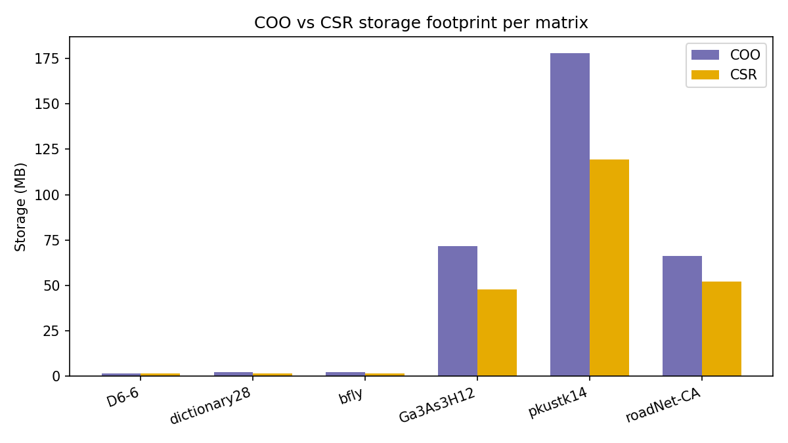
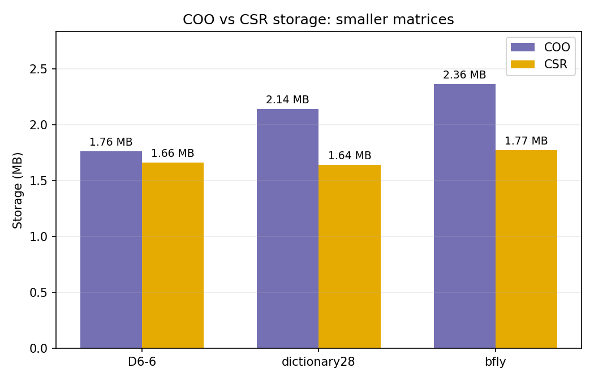
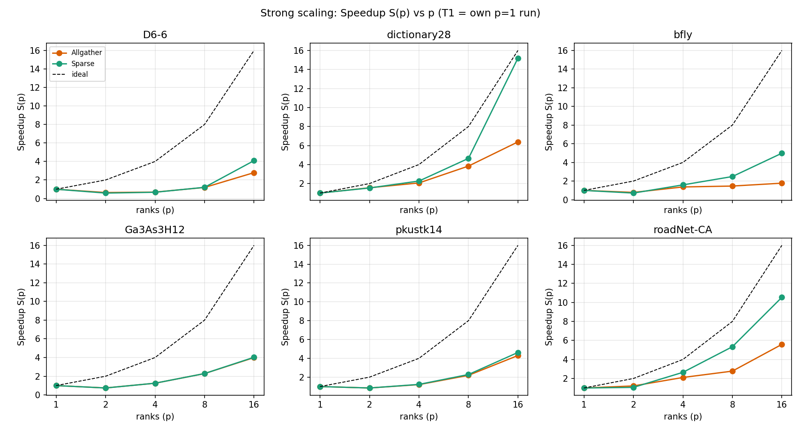
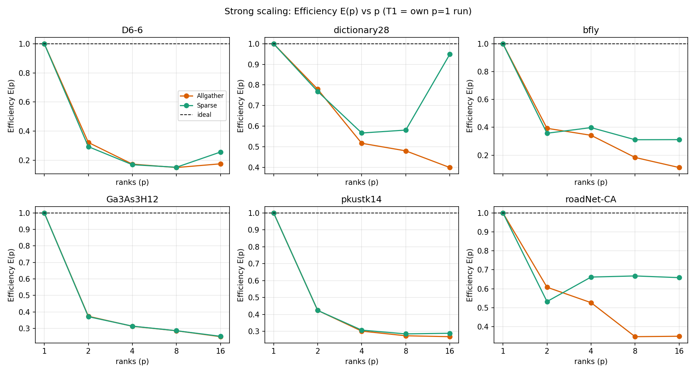
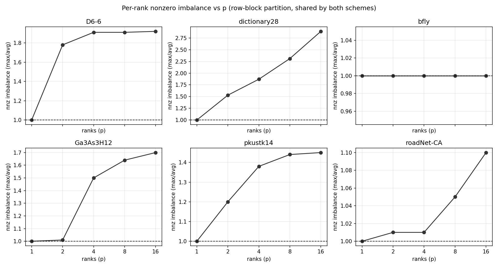
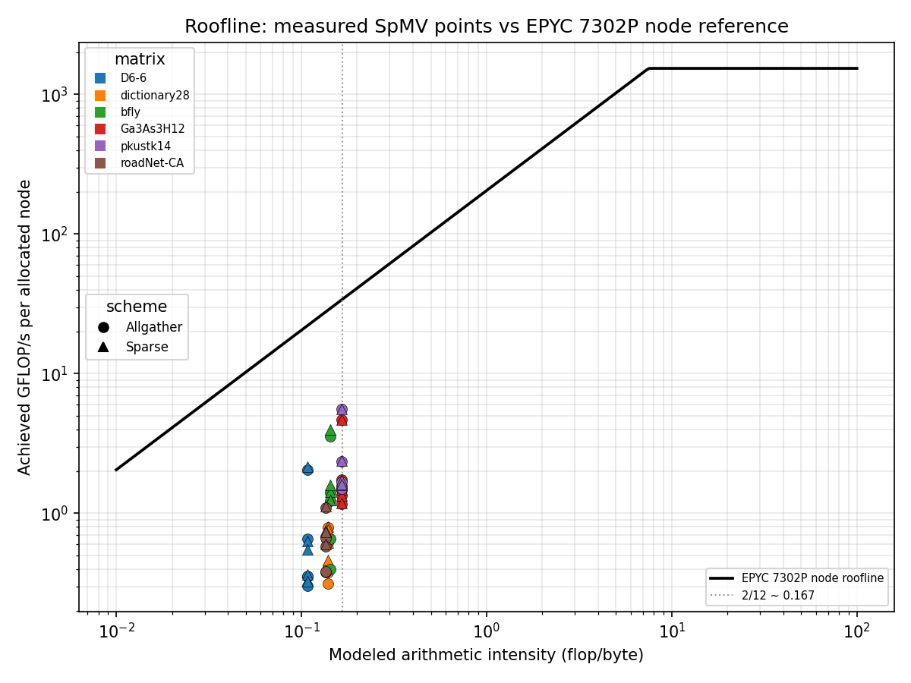
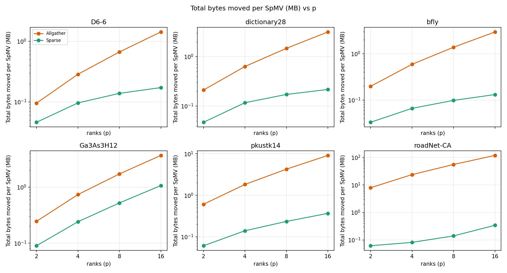
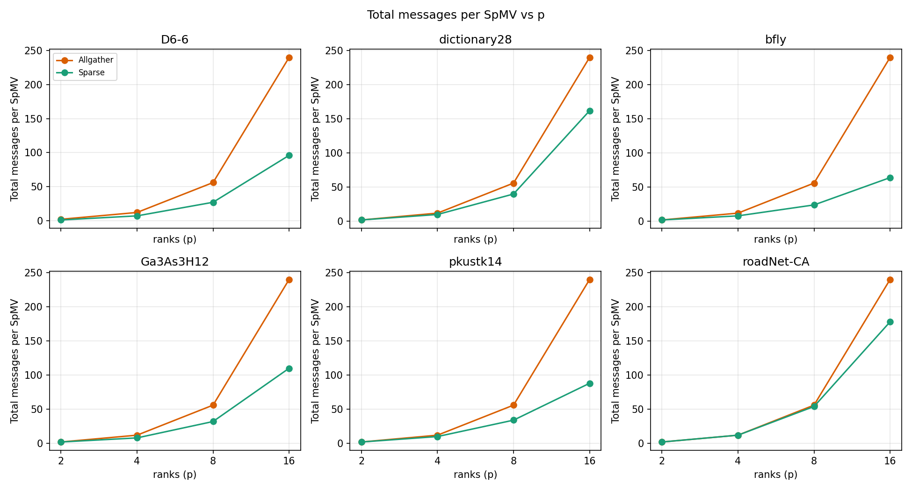

# HW1 - Distributed SpMV with MPI: Report

### Name: Harsha Puvvadi

This report presents the design, performance analysis, and per-matrix behavior for Homework 1. All benchmarks were evaluated on the **NCSU ARC cluster** (`normal` partition) using both the `spmv_mpi_allgather` and `spmv_mpi_sparse` implementations.

**Experimental configuration.** I used one rank per node for every process count `p ∈ {1, 2, 4, 8, 16}`, so every multi-rank run exercised inter-node communication and avoided intra-node bandwidth contention. The five process counts were submitted as separate Slurm jobs, and later inspection showed that the `normal` partition supplied heterogeneous hardware. The `p=2` allocation combined an AMD EPYC 7313P node with an Intel Xeon Silver 4215 node; `p=4` and `p=8` used AMD EPYC 7302P nodes; and `p=16` combined thirteen AMD EPYC 8124P nodes with three EPYC 7302P nodes. The processor assigned to the `p=1` job could not be found. Both communication schemes at a given `p` ran on the same allocation, so their direct comparison remains meaningful. Comparisons across different values of `p`, however, include both rank-count and processor effects and must be interpreted as observed scaling on these allocations rather than hardware-isolated strong scaling.

All 60 runs (6 matrices × p ∈ {1,2,4,8,16} × 2 schemes) report `PASS` against the sequential CSR baseline.

---

## 3a. Write-up: design decisions, results, per-matrix behavior, anomalies

### Design decisions

#### Task 1 (`spmv_mpi_allgather.c`)

`spmv_mpi_setup()` allocates a full-length `x_full` buffer and copies the per-rank contribution sizes and destination offsets from `counts` and `displs`. During each call to `spmv_mpi()`, `MPI_Allgatherv` collects every rank's local portion of `x` into `x_full`. Each rank then computes the CSR dot products for its locally owned rows, accessing vector elements through their global column indices as `x_full[col_idx[k]]`.

The main design choice concerns the communication accounting in `spmv_mpi_stats()`. Because the internal algorithm used by `MPI_Allgatherv` depends on the MPI implementation, the reported message and byte counts use a "direct all-to-all dissemination" model, where each rank sends its local portion of `x` directly to each of the other `p−1` ranks. Under this model, **message count** depends only on `p`: every rank sends `p−1` messages regardless of the matrix.

#### Task 2 (`spmv_mpi_sparse.c`)

<!-- **`spmv_mpi_allgather.c` (Task 1).** `spmv_mpi_setup()` allocates one
full-length `x_full` buffer (`num_cols` floats) per rank and copies the
harness's `counts`/`displs`. `spmv_mpi()` is exactly the two steps the
assignment describes: `MPI_Allgatherv` the whole `x` into `x_full`, then a
row-at-a-time CSR dot product reading `x_full[col_idx[k]]`. The only design
choice here is in `spmv_mpi_stats()`: since `MPI_Allgatherv`'s actual message
count depends on Open MPI's internal algorithm selection (message-size- and
rank-count-dependent), we report under an explicit model: each rank
broadcasts its own local chunk of `x` (`own_count` floats) directly to each
of the other `p−1` ranks — `p−1` messages sent, `own_count` floats per
message. This is a deliberate modeling choice, not a measurement of Open
MPI's actual internal algorithm — stated once here per the assignment's
"state your model" requirement. Under this model, **message count** depends
only on `p`: every rank always sends `p−1` messages regardless of matrix
(visible in `figures/comm_messages.png`: all six matrices' Allgather lines
are identical, `16 × 15 = 240` at `p=16` summed over ranks, matching the
table exactly). **Byte volume** is not matrix-independent, though: summed
over all ranks it is exactly `(p−1) × num_cols × 4` bytes for any matrix
(each rank's own chunk is broadcast `p−1` times, and all ranks' chunks sum to
`num_cols`), so it scales with each matrix's vector length, not its nonzero
count or sparsity structure — which is why Allgather's byte column in
`communication.csv` varies by two orders of magnitude across matrices at the
same `p` (1.4 MB for `D6-6` vs. 118.3 MB for `roadNet-CA` at p=16). -->

For this task, the implementation keeps the same local CSR kernel as Allgather but replaces its communication with a reusable plan built in `spmv_mpi_setup()`.

The sparse implementation communicates only the remote `x` entries referenced by the rank's local CSR rows. During `spmv_mpi_setup()`, each rank identifies its distinct remote column dependencies and exchanges those column indices with their owners. This produces a reusable communication plan describing which values the rank must receive and which local values it must send.

The main design decisions were:

1. **Build and reuse the communication plan.** All dependency discovery, ownership lookup, and request exchange occur once in `spmv_mpi_setup()`. The timed `spmv_mpi()` loop therefore performs only value packing, point-to-point communication, unpacking, and the local CSR computation.

2. **Use a bitmap to remove duplicate requests.** A `seen[]` bitmap of length `num_cols` marks every global column referenced by the local rows. Scanning the bitmap in increasing column order creates deterministic, duplicate-free request lists grouped by owner. This uses `O(num_cols)` temporary setup memory but avoids repeatedly requesting an `x` value referenced by multiple nonzeros.

3. **Coalesce communication by peer.** All values needed from the same rank are grouped into one message per iteration. Receives are posted first with `MPI_Irecv`, followed by `MPI_Isend` calls and one `MPI_Waitall`. This avoids blocking-order dependencies and reduces message count compared with sending each requested value separately.

4. **Retain global column indexing.** The implementation uses a full-length `x_buf` rather than remapping `col_idx` into a compact local index space. Local and received values can therefore be placed directly at their global indices, and the CSR kernel remains the simple expression `x_buf[col_idx[k]]`. The tradeoff is `O(num_cols)` memory per rank, up to 7.885 MB for `roadNet-CA` in exchange for simpler setup, unpacking, and computation.

<!-- `spmv_mpi_stats()` reports the actual number of `MPI_Isend` calls and the corresponding float payloads issued during one SpMV iteration.

One implementation choice worth flagging: `x_buf` is full-length
(`num_cols` floats) exactly like the allgather scheme's `x_full`, rather than a
compacted buffer with `col_idx` remapped in `setup()`. This trades O(num_cols)
memory per rank (acceptable at these problem sizes — largest is `roadNet-CA`
at 1,971,281 columns, 7.885 MB per rank) for a kernel loop identical to the allgather
version, and for the ability to unpack incoming values by their true global
index directly rather than through an indirection table. A compacted buffer
would save memory and might improve cache locality on very large, very sparse
matrices, at the cost of an extra remap step in `setup()` and a second lookup
per nonzero in `spmv_mpi()`. -->

### Results and per-matrix behavior

The six matrices cover different sizes, row densities, load distributions, and communication patterns. Their average nonzeros per row range from 1.22 for `D6-6` to 97.66 for `pkustk14`. Row density helps explain storage and arithmetic intensity, but the scaling results also depend on load imbalance and on how each matrix's column references align with the row-block partition.

**Major anomaly observed:** `D6-6`, `bfly`, `Ga3As3H12`, and `pkustk14` become slower from `p=1` to `p=2` for both communication schemes. For example, `bfly` increases from 0.110 to 0.140 ms with Allgather and from 0.098 to 0.137 ms with Sparse. The `p=1` run performs no network exchange, whereas `p=2` introduces inter-node startup and synchronization costs. However, the `p=2` allocation also combined an AMD EPYC 7313P node with an Intel Xeon Silver 4215 node, and execution is limited by the slower rank. The experiment therefore cannot separate network overhead from processor heterogeneity. I treat the slowdown as an allocation-specific anomaly rather than a property of either communication scheme.

**`D6-6`.** This is the only rectangular matrix, with 120,576 rows and 23,740 columns. Both implementations pass at every process count, confirming that the row partition of `A` and column partition of `x` were handled independently. Its imbalance increases to 1.92× at `p=16`, the highest growth among the six matrices. With only 146,880 nonzeros and an average of 1.22 nonzeros per row, there is very little computation available to offset the cost of inter-node communication. This explains why neither scheme recovers its `p=1` performance by `p=4`.

**`dictionary28`.** This matrix produces the cleanest scaling behavior in the sweep and does not show the `p=2` slowdown. Its communication savings increase from 4.5× to 14.6×, even though its load imbalance reaches 2.89× at `p=16`. Sparse achieves 12.15 GFLOP/s and an efficiency of 0.949 at `p=16`, which is the highest measured efficiency among all matrix and scheme combinations.

**`bfly`.** The nonzeros are perfectly balanced at every process count, with an imbalance of 1.00×. Despite this balance, Allgather scales weakly after `p=4`, and its efficiency falls to 0.111 at `p=16`. The matrix contains only 196,608 nonzeros, so communication quickly becomes larger than the remaining computation per rank. At `p=16`, Sparse communicates 0.13 MB instead of Allgather's 2.95 MB and reaches 20.0 GFLOP/s compared with 6.3 GFLOP/s for Allgather. This is the clearest case where communicating only the required `x` entries improves performance.

**`roadNet-CA`.** Both schemes improve monotonically as the process count increases. At `p=16`, Allgather reaches 6.12 GFLOP/s with an efficiency of 0.349, while Sparse reaches 11.83 GFLOP/s with an efficiency of 0.658. Sparse reduces communication by 129× to 397× across the sweep, the largest reduction among all six matrices. The measured communication pattern shows that most referenced columns are locally owned under the row-block partition. This is consistent with locality in the matrix ordering, although the relationship between node identifiers and geographic position was not independently verified.

**`Ga3As3H12` and `pkustk14`.** Both matrices have approximately 97 nonzeros per row and therefore similar arithmetic intensity, but their communication behavior is very different. The maximum reduction for `Ga3As3H12` is only 3.45×, while `pkustk14` reaches a 24.8× reduction at `p=16`. Sparse reaches 18.9 GFLOP/s for `Ga3As3H12` and 25.9 GFLOP/s for `pkustk14` at `p=16`. This comparison shows that row density predicts arithmetic intensity but does not predict communication locality; locality depends on the positions of the nonzeros and how those positions align with the partition boundaries.

---

## 3b. Format storage: CSR vs. COO

The storage comparison is based on the array data types used by the provided implementation. Both formats store matrix values as 4-byte `float` values and indices as 4-byte `int` values. The reported footprints represent the main arrays required to store the sparse matrix, and they do not include structure metadata, memory-allocation overhead, MPI communication buffers, or the `x` and `y` vectors.

| matrix       |      rows |      cols |        nnz | avg nnz/row | COO (MB) | CSR (MB) | CSR/COO |
| ------------ | --------: | --------: | ---------: | ----------: | -------: | -------: | ------: |
| D6-6         |   120,576 |    23,740 |    146,880 |        1.22 |     1.76 |     1.66 |   0.940 |
| dictionary28 |    52,652 |    52,652 |    178,076 |        3.38 |     2.14 |     1.64 |   0.765 |
| bfly         |    49,152 |    49,152 |    196,608 |        4.00 |     2.36 |     1.77 |   0.750 |
| roadNet-CA   | 1,971,281 | 1,971,281 |  5,533,214 |        2.81 |    66.40 |    52.15 |   0.785 |
| Ga3As3H12    |    61,349 |    61,349 |  5,970,947 |       97.33 |    71.65 |    48.01 |   0.670 |
| pkustk14     |   151,926 |   151,926 | 14,836,504 |       97.66 |   178.04 |   119.30 |   0.670 |

<!-- (`SpMV/analysis/tables/storage.csv`, `SpMV/analysis/figures/storage_comparison.png`.) -->

### COO storage

The Coordinate format stores one complete `(row, column, value)` tuple for every nonzero. Therefore, each nonzero requires:

1. Row index: 4-byte `int`
2. Column index: 4-byte `int`
3. Value: 4-byte `float`

The total COO storage is consequently:

```text
COO bytes = nnz × (4 + 4 + 4)
          = 12 × nnz
```

### CSR storage

The Compressed Sparse Row format removes the explicit row index from every nonzero. Each nonzero stores only:

1. Column index: 4-byte `int`
2. Value: 4-byte `float`

CSR represents row boundaries using a separate `row_ptr` array. For a matrix with `rows` rows, this array contains `rows+1` 4-byte integer offsets. The additional final entry marks the end of the last row.
The total CSR storage is therefore:

```
CSR bytes = nnz × (4 + 4) + (rows + 1) × 4
          = 8 × nnz + 4 × (rows + 1)
```

The storage ratio between the formats is:

```
CSR/COO = [8 × nnz + 4 × (rows + 1)] / [12 × nnz]

        = 2/3 + (rows + 1) / (3 × nnz)
```

Using the average number of nonzeros per row,

```
avg_nnz_per_row = nnz / rows
```

The ratio can be approximated as:

```
CSR/COO ≈ 2/3 + 1 / (3 × avg_nnz_per_row)
```

This expression explains why the CSR-to-COO ratio differs between matrices. The main factor is the average number of nonzeros per row (`avg_nnz_per_row`), rather than the total matrix size.

**Observations:** For matrices with many nonzeros per row, CSR replaces many repeated COO row indices with only one `row_ptr` entry per row. The cost of `row_ptr` is distributed across many nonzeros, making the ratio approach its lower bound of `2/3`. CSR can therefore approach a 33.33% reduction because its per-nonzero storage is 8 bytes instead of COO's 12 bytes. The comparison across all matrices is shown below.



The smaller storage footprints are difficult to compare on the full chart because the larger matrices determine its vertical scale. The following chart shows `D6-6`, `dictionary28`, and `bfly` separately using a reduced scale.

`D6-6` contains only 1.22 nonzeros per row. Its 120,577-entry `row_ptr` array is almost as long as the number of nonzeros, so CSR is only approximately 6% smaller than COO.



Matrices such as `dictionary28`, `bfly`, and `roadNet-CA` contain between 2.81 and 4.00 nonzeros per row. Their `row_ptr` costs are spread across several nonzeros per row, producing storage reductions of approximately 21.5% to 25.0%. The larger absolute size of `roadNet-CA` does not produce a better ratio because it also has nearly two million rows, while its average row density remains only 2.81 nonzeros per row. This confirms that the CSR reduction is driven by the average number of nonzeros per row.

Finally, `Ga3As3H12` and `pkustk14` each contain approximately 97 nonzeros per row. Their `row_ptr` arrays are very small relative to their nonzero arrays, so their CSR/COO ratios approach the theoretical lower limit of `2/3`.

## 3c. Performance and Scaling

To measure the observed scaling, I calculated speedup ($S(p) = T_1 / T_p$) and efficiency ($E(p) = S(p) / p$) by comparing each program against its own 1-rank MPI run ($T_1$). This keeps the executable and implementation fixed, but it does not isolate rank count from hardware: the separately scheduled jobs used different or mixed processor models. The curves therefore describe the performance obtained on these allocations, not a controlled same-hardware strong-scaling experiment. Comparisons between Allgather and Sparse at the same `p` are more reliable because both schemes used the same nodes.



**Overall scaling trend.** Every matrix-scheme combination finishes faster at `p=16` than at `p=1`, showing that distributing the rows exposes useful parallel work. Several matrices initially slow down at `p=2`, where the reduced local computation must offset inter-node startup and synchronization while the allocation also mixes two processor models. Performance improves more clearly from `p=4` onward, but the magnitude of that improvement cannot be attributed to parallelism alone because the hardware changes across the sweep.

Sparse is generally equal to or faster than Allgather. At `p=2`, the schemes split evenly: Allgather is faster for `D6-6`, `Ga3As3H12`, and `roadNet-CA`, while Sparse is faster for `dictionary28`, `bfly`, and `pkustk14`, with several differences within only a few percent. From `p=4` onward, Sparse is faster in all 18 matrix/process-count comparisons and wins 21 of the 24 multi-rank comparisons overall. This shows that reducing the communicated portion of `x` becomes more beneficial as the number of ranks increases.

**Matrix speedup comparison.** `dictionary28` with Sparse produces the strongest curve, reaching a speedup of 15.19 at `p=16`. `roadNet-CA` also gains a clear advantage from Sparse, reaching 10.53 speedup compared with 5.58 for Allgather. Its well-balanced row partition and strong communication locality allow the sparse exchange to avoid most unneeded vector transfers as ranks are added.

`Ga3As3H12` gains from parallel execution, but Sparse provides almost no additional advantage: both schemes reach approximately 4× speedup at `p=16`. Its substantial local computation, limited communication locality, and 1.70× nonzero imbalance affect both schemes, so the smaller Sparse exchange does not noticeably reduce the total execution time. `pkustk14` behaves similarly, although Sparse reaches a slightly higher speedup of 4.62 compared with 4.30 for Allgather. Its large local workload and shared imbalance keep the two curves relatively close.



**Efficiency trend.** Efficiency measures the observed speedup relative to the ideal factor of `p`. Sparse `dictionary28` reaches the highest reported `p=16` efficiency at 0.949, while Sparse `roadNet-CA` reaches 0.658. `Ga3As3H12` and `pkustk14` reach approximately 0.25–0.29; `D6-6` reaches 0.175 with Allgather and 0.256 with Sparse; and `bfly` reaches 0.111 and 0.312. Sparse retains more measured efficiency than Allgather at higher rank counts, consistent with its smaller communication volume. These values are not hardware-normalized, so the newer EPYC 8124P processors in most of the `p=16` allocation may also raise the reported efficiencies.



The imbalance results show that strong scaling depends on both communication and the distribution of nonzeros. A high imbalance forces all ranks to wait for the rank with the largest local partition, while a balanced matrix can still scale poorly when its computation becomes too small to amortize communication. The contrast between `D6-6` and `bfly` demonstrates these two limits: `D6-6` is affected by both imbalance and communication, whereas `bfly` isolates communication as the main source of lost efficiency.

### Roofline

The roofline quantities were derived as follows. For each nonzero, CSR-SpMV performs one multiplication and one addition, so the operation count is

$$W = 2\,\mathrm{nnz}\quad\text{FLOPs}.$$

The memory-traffic model counts a 4-byte matrix value, a 4-byte column index, and a 4-byte element of `x` for each nonzero. It also approximates the `row_ptr` access and output write as one 4-byte integer and one 4-byte float per row:

$$Q = (4+4+4)\,\mathrm{nnz}+(4+4)\,\mathrm{rows} = 12\,\mathrm{nnz}+8\,\mathrm{rows}\quad\text{bytes}.$$

Therefore, the arithmetic intensity is

$$AI=\frac{W}{Q}=\frac{2\,\mathrm{nnz}}{12\,\mathrm{nnz}+8\,\mathrm{rows}}.$$

Dividing the numerator and denominator by `nnz`, and using $d=\mathrm{nnz}/\mathrm{rows}$ for the average nonzeros per row, gives

$$AI=\frac{2}{12+8(\mathrm{rows}/\mathrm{nnz})}=\frac{2}{12+8/d}\quad\text{flop/byte}.$$

For example, `D6-6` has $d=146{,}880/120{,}576=1.218$, so

$$AI_{\text{D6-6}}=\frac{2}{12+8/1.218}=0.1077\quad\text{flop/byte}.$$

For dense rows, $d$ becomes large and $8/d$ approaches zero. Thus,

$$\lim_{d\to\infty}AI=\frac{2}{12}=0.1667\quad\text{flop/byte}.$$

This explains the measured range from approximately 0.107 flop/byte for `D6-6` to 0.166 flop/byte for `Ga3As3H12` and `pkustk14`.



| matrix       | $p$ | $I$ (flop/byte) | Allgather GFLOP/s per node | Sparse GFLOP/s per node |
| ------------ | --: | --------------: | -------------------------: | ----------------------: |
| D6-6         |   1 |          0.1077 |                      2.040 |                   2.160 |
| D6-6         |   2 |          0.1077 |                      0.655 |                   0.635 |
| D6-6         |   4 |          0.1077 |                      0.352 |                   0.365 |
| D6-6         |   8 |          0.1077 |                      0.304 |                   0.326 |
| D6-6         |  16 |          0.1077 |                      0.357 |                   0.553 |
| dictionary28 |   1 |          0.1392 |                      0.790 |                   0.800 |
| dictionary28 |   2 |          0.1392 |                      0.615 |                   0.615 |
| dictionary28 |   4 |          0.1392 |                      0.407 |                   0.453 |
| dictionary28 |   8 |          0.1392 |                      0.379 |                   0.465 |
| dictionary28 |  16 |          0.1392 |                      0.314 |                   0.759 |
| bfly         |   1 |          0.1429 |                      3.570 |                   4.000 |
| bfly         |   2 |          0.1429 |                      1.400 |                   1.430 |
| bfly         |   4 |          0.1429 |                      1.222 |                   1.595 |
| bfly         |   8 |          0.1429 |                      0.654 |                   1.244 |
| bfly         |  16 |          0.1429 |                      0.396 |                   1.251 |
| Ga3As3H12    |   1 |          0.1655 |                      4.690 |                   4.700 |
| Ga3As3H12    |   2 |          0.1655 |                      1.750 |                   1.745 |
| Ga3As3H12    |   4 |          0.1655 |                      1.465 |                   1.472 |
| Ga3As3H12    |   8 |          0.1655 |                      1.337 |                   1.343 |
| Ga3As3H12    |  16 |          0.1655 |                      1.170 |                   1.184 |
| pkustk14     |   1 |          0.1655 |                      5.580 |                   5.600 |
| pkustk14     |   2 |          0.1655 |                      2.365 |                   2.375 |
| pkustk14     |   4 |          0.1655 |                      1.683 |                   1.722 |
| pkustk14     |   8 |          0.1655 |                      1.530 |                   1.596 |
| pkustk14     |  16 |          0.1655 |                      1.500 |                   1.618 |
| roadNet-CA   |   1 |          0.1347 |                      1.100 |                   1.120 |
| roadNet-CA   |   2 |          0.1347 |                      0.665 |                   0.600 |
| roadNet-CA   |   4 |          0.1347 |                      0.578 |                   0.743 |
| roadNet-CA   |   8 |          0.1347 |                      0.380 |                   0.750 |
| roadNet-CA   |  16 |          0.1347 |                      0.383 |                   0.739 |

**Disclaimer:** Because the sweep used heterogeneous processors, no single machine roof describes every point. I use the AMD EPYC 7302P as the node reference because this processor model was used by the homogeneous `p=4` and `p=8` allocations. The plotted performance is the aggregate GFLOP/s divided by `p`, giving GFLOP/s per allocated node. Only one rank and one core were active on each node, so the measurements are expected to remain well below the full-node roof. The roof is not used to compare the absolute hardware efficiency of points obtained on other processors.

The EPYC 7302P supports eight DDR4-3200 memory channels. Each channel transfers 3.2 billion values per second over an 8-byte-wide interface, giving the theoretical node bandwidth

$$\beta=(8\ \mathrm{channels})(3.2\times10^9\ \mathrm{transfers/s})(8\ \mathrm{bytes})=204.8\ \mathrm{GB/s}.$$

The theoretical node compute ceiling uses 16 cores, a 3.0 GHz base clock, eight single-precision values per 256-bit AVX2 vector, two vector FMA instructions per core per cycle, and two FLOPs per FMA:

$$\pi=(16\ \mathrm{cores})(3.0\times10^9\ \mathrm{cycles/s})(8\ \mathrm{values})(2\ \mathrm{FMA/cycle})(2\ \mathrm{FLOPs/FMA}),$$

$$\pi=1536\times10^9\ \mathrm{FLOP/s}=1536\ \mathrm{GFLOP/s}.$$

These are theoretical full-node limits rather than measured sustained rates. The SpMV experiment used only one core per node, and the compiled kernel was not inspected to confirm full AVX2 vectorization or two-FMA-per-cycle execution.

The roofline performance bound is

$$P(I)=\min\!\left(\pi,\ \beta I\right).$$

The ridge point is where the memory and compute ceilings intersect:

$$\beta I^*=\pi,$$

$$I^*=\frac{\pi}{\beta}=\frac{1536\ \mathrm{GFLOP/s}}{204.8\ \mathrm{GB/s}}=7.50\ \mathrm{flop/byte}.$$

**Roofline observations:** Every matrix has $I\in[0.107,0.166]\ll7.50$, placing all six far to the left of the EPYC 7302P node ridge. Their applicable ceiling is therefore the sloped memory roof $\beta I$, not the 1536 GFLOP/s compute roof. `D6-6`, with the lowest intensity, has a theoretical node ceiling of $204.8(0.1077)=22.06$ GFLOP/s, while the denser `Ga3As3H12` and `pkustk14` matrices reach the highest ceiling:

$$P_{\mathrm{mem}}=I\beta=(0.1655)(204.8)=33.89\ \mathrm{GFLOP/s}.$$

At `p=8`, where all ranks ran on EPYC 7302P nodes, Sparse `pkustk14` achieves 1.596 GFLOP/s per node, or $1.596/33.89=4.7\%$ of the theoretical node memory roof. Much of this gap is expected because the placement activates only one of the node's 16 cores. Irregular `x` accesses, MPI communication, synchronization, and the simplified arithmetic-intensity model reduce the measured performance further. The intensity model counts only CSR memory traffic and does not include network traffic.

**Roofline inference and conclusion:** Even the densest matrix would need about $7.50/0.166=45\times$ more work per byte to reach the compute-bound side of the graph. This is not realistic for CSR-SpMV, so the maximum compute speed of the processor is not the main limit. The main limit is moving matrix and vector data from memory. Therefore, improving memory locality and reducing unnecessary communication would be more useful than trying to reach the compute peak. Sparse often appears above Allgather because it sends fewer vector values between nodes, although this network traffic is not included in the basic roofline calculation.

---

## 3d. Communication analysis

Communication Cost:

$$C_{\mathrm{comm}}=M\alpha+B\beta_{\mathrm{net}},$$

where $M$ is the number of messages, $B$ is the total payload in bytes, $\alpha$ is the fixed startup cost of one message, and $\beta_{\mathrm{net}}$ is the transfer cost per byte. This $\beta_{\mathrm{net}}$ is different from the memory bandwidth $\beta$ used in the Roofline section. Reducing $M$ lowers the repeated startup cost, while reducing $B$ lowers the data-transfer cost.

**Allgather model:** `MPI_Allgatherv` using direct dissemination. If rank $r$ owns $n_r$ values of `x`, it sends that chunk directly to each of the other $p-1$ ranks. Its reported cost is therefore

$$M_r=p-1,\qquad B_r=4n_r(p-1),$$

because every value is a four-byte `float`. The harness sums these values across all ranks. Since the owned chunks together contain the complete vector, $\sum_r n_r=\mathrm{num\_cols}$, the totals are

$$M_{\mathrm{Allgather}}=\sum_{r=0}^{p-1}(p-1)=p(p-1),$$

$$B_{\mathrm{Allgather}}=\sum_{r=0}^{p-1}4n_r(p-1)=4(p-1)\,\mathrm{num\_cols}.$$

This is an accounting model rather than a measurement of the internal algorithm selected by MPI. A ring Allgather uses $p-1$ rounds with one send per rank in every round, so it has the same summed message and byte totals, although its communication schedule differs from direct dissemination.

**Sparse exchange:** Let $S_r$ be the set of peers to which rank $r$ sends values, and let $q_{rs}$ be the number of requested floats sent from rank $r$ to peer $s$. The implementation packs all values requested by one peer into one `MPI_Isend`, giving

$$M_{\mathrm{Sparse}}=\sum_{r=0}^{p-1}|S_r|,$$

$$B_{\mathrm{Sparse}}=4\sum_{r=0}^{p-1}\sum_{s\in S_r}q_{rs}.$$

These are the actual messages and payloads sent by the reusable communication plan. Packing by peer avoids sending one message per vector entry and therefore reduces the repeated $\alpha$ cost. The setup `MPI_Alltoall` and `MPI_Alltoallv` calls are excluded because they build the plan once and are not performed during each SpMV.

| matrix       |   p | messages Allgather | messages Sparse | bytes Allgather (MB) | bytes Sparse (MB) | savings (×) |
| ------------ | --: | -----------------: | --------------: | -------------------: | ----------------: | ----------: |
| D6-6         |  16 |                240 |              96 |                1.424 |             0.172 |         8.3 |
| dictionary28 |  16 |                240 |             162 |                3.159 |             0.217 |        14.6 |
| bfly         |  16 |                240 |              64 |                2.949 |             0.131 |        22.5 |
| Ga3As3H12    |  16 |                240 |             110 |                3.681 |             1.067 |         3.4 |
| pkustk14     |  16 |                240 |              88 |                9.116 |             0.367 |        24.8 |
| roadNet-CA   |  16 |                240 |             178 |              118.277 |             0.339 |       348.9 |



**Overall byte-volume trend:** Allgather communicates the complete vector regardless of which entries a rank's rows use, so its byte volume increases with both `num_cols` and `p`. Sparse communicates only distinct remote entries that are actually referenced. Its advantage therefore depends on communication locality: it saves the most when a rank's rows mainly reference columns owned by that same rank, and it saves less when references are distributed across remote owners.

**Largest Sparse advantage:** `roadNet-CA` shows the strongest locality under the row-block partition. Allgather traffic increases from 7.885 MB at `p=2` to 118.277 MB at `p=16` because the complete 1,971,281-element vector is repeatedly distributed. Sparse moves only 0.061 to 0.339 MB over the same range. This produces a reduction of 129× to 397×, including 348.9× at `p=16`. The result indicates that most vector entries referenced by a rank are locally owned, leaving only a small set of remote dependencies to exchange.

**Smallest Sparse advantage:** `Ga3As3H12` reduces communication from 3.681 MB with Allgather to 1.067 MB with Sparse at `p=16`, a reduction of only 3.45×. This is the smallest saving in the dataset and indicates that its referenced columns are distributed more broadly across rank ownership ranges. Sparse must therefore fetch a comparatively large fraction of the remote vector, which explains why its runtime remains close to Allgather.

The remaining matrices fall between these cases. At `p=16`, Sparse reduces communication by 8.3× for `D6-6`, 14.6× for `dictionary28`, 22.5× for `bfly`, and 24.8× for `pkustk14`. The contrast between `Ga3As3H12` and `pkustk14` is especially important: both average approximately 97 nonzeros per row, yet their communication reductions are 3.45× and 24.8×. Average row density therefore explains storage and arithmetic intensity, but it does not determine communication locality. The positions of the column references relative to the partition boundaries determine how much Sparse can avoid sending.



**Message-count trend:** Under the Allgather model, message count depends only on `p`, producing `p(p−1)` messages for every matrix: 2 messages at `p=2` and 240 at `p=16`. Sparse sends at most one packed message to each peer with requested values, so its message count depends on how many distinct rank pairs exchange data.

At `p=16`, Sparse uses 64 messages for `bfly`, 88 for `pkustk14`, 96 for `D6-6`, 110 for `Ga3As3H12`, 162 for `dictionary28`, and 178 for `roadNet-CA`, compared with 240 under the Allgather model. The ordering differs from the byte-savings result because message count and payload size measure different properties. `roadNet-CA`, for example, reduces bytes by 348.9× but messages by only 26%. It still communicates with many peers, but each packed message contains very few values. In contrast, `bfly` reduces both the number of peers contacted and the total payload, resulting in 73% fewer messages and 22.5× fewer bytes. Therefore, `roadNet-CA` greatly reduces the $B\beta_{\mathrm{net}}$ part of the cost, while `bfly` reduces both $M\alpha$ and $B\beta_{\mathrm{net}}$ more clearly.
