# HW2 - Node-Level Sparse Matrix–Vector Multiplication

<!-- **OpenMP, AVX2, CSR, ELL, and load balancing**   -->

**Name**: Harsha Vardhan Puvvadi
**Measurement node:** ARC c57, AMD EPYC 7302P

## Abstract

This report discusses the implementations of four independently built SpMV kernels: OpenMP CSR, OpenMP ELL, AVX2 CSR, and AVX2 ELL. On six SuiteSparse matrices, all 516 recorded benchmark runs passed the supplied CSR correctness check. The results show that row-length distribution, padding, and scheduling overhead matter as much as the availability of threads and vector lanes. At eight threads, ELL is slightly faster than CSR on `bfly` and faster on `D6-6`, but 46.9 times slower on `Ga3As3H12`, where 94% of its slots are padding. Nonzero partitioning nearly eliminates CSR's measured work imbalance on the two required high-variance matrices. A dynamic chunk of one also improves balance, but makes CSR 3.9–4.2 times slower than static scheduling. STREAM Triad measured 100.45 GB/s on the same node (the processor's theoretical bandwidth specification is 204.8 GB/s). These limits, together with irregular `x` gathers and ELL padding, explain why adding cores or SIMD lanes rarely gives proportional speedup.

## 1. Methods and implementation

### Hardware, datasets, and measurements

The experiments used one ARC `rome` compute node, **c57**, with one AMD EPYC 7302P (16 physical cores, 32 hardware threads), 16 allocated CPUs, GCC 12.4.0, and OpenMP binding `OMP_PROC_BIND=close`, `OMP_PLACES=cores`, `OMP_DYNAMIC=FALSE`. ARC lists its Rome nodes with 128 GB DDR4-3200 memory. All timed binaries were rebuilt on c57. The AVX2 targets used the provided `-march=native` rule. [ARC hardware description](https://arcm.csc.ncsu.edu/~mueller/cluster/arc/), [AMD processor specification](https://www.amd.com/en/support/downloads/drivers.html/processors/epyc/epyc-7002-series/amd-epyc-7302p.html).

The six assigned matrices are `D6-6`, `dictionary28`, `bfly`, `Ga3As3H12`, `pkustk14`, and `roadNet-CA`. The MatrixMarket reader expands symmetric input before measurement. The timing harness generates the same `x`, checks against sequential CSR, warms the kernel, and chooses an iteration count. For every four-kernel × six-matrix × five-thread scaling case, I made **three independent runs** with the default static row schedule and report the **median ms per iteration**. Thread counts were 1, 2, 4, 8, and 16. Schedule experiments used eight threads and three runs per case. The sequential CSR baseline was recorded once per matrix; it is shown in the roofline but is **not** the denominator for my thread-speedup plots. This distinction avoids mixing a separately measured program with each kernel's scaling curve.

`PASS` requires relative L2 error below $10^{-5}$; the scalar OpenMP files yielded exactly zero error in every run. The largest recorded SIMD error was $4.744\times10^{-7}$.

### Code design

The submitted C files implement `spmv_omp_setup`, `spmv_omp`, `spmv_omp_stats`, and `spmv_omp_teardown` independently. Setup stores the partition option and precomputes fixed row ranges. Both ELL files also convert CSR into column-major arrays, with entry $(i,k)$ at $k \times m+i$ and zero-filled padding. The row-partitioned path uses OpenMP `schedule(runtime)`. The nonzero-partitioned path gives each thread a precomputed, contiguous range of **whole rows**, chosen by binary search in CSR's `row_ptr`. Every output row has one owner, so no atomic operation or cross-thread reduction is needed.

The CSR AVX2 kernel gathers eight `x[col_idx]` values within a row, accumulates with FMA, reduces the eight lanes, and handles the remainder scalarly. The ELL AVX2 kernel uses contiguous loads for eight neighboring rows' values and column indices, gathers `x`, and maintains eight independent accumulators; it handles the final short row block scalarly. Its row path parallelizes over **blocks of eight rows**, so a `--schedule` chunk denotes blocks rather than individual rows in this one kernel. The separate setup and timed-kernel phases ensure that conversion and partition calculation are not hidden in the SpMV time.

## 2. Format geometry and storage

CSR matrix storage is $8\,\mathrm{nnz}+4(m+1)$ bytes: one 32-bit column index and one float per nonzero, plus row pointers. ELL matrix storage is $8mK$ bytes, where $K$ is the longest row. These figures exclude `x` and `y` and use decimal MB. Padding is $(mK-\mathrm{nnz})/(mK)$. The conversion's reported $K$ and slot count matched the harness checks.

For CSR row $i$, calculate its length from consecutive row pointers:

$$\ell_i=\texttt{row\_ptr}[i+1]-\texttt{row\_ptr}[i].$$

Now scan all $m$ rows of the expanded CSR matrix and calculate the maximum row length as

$$
K=\max_{0\le i<m}\ell_i
=\max_{0\le i<m}\left(\texttt{row\_ptr}[i+1]-\texttt{row\_ptr}[i]\right).
$$

The column-major ELL value and column-index arrays consequently contain $mK$ slots each. For example, `Ga3As3H12` has $m=61{,}349$ rows and $K=1{,}622$, giving

$$mK=61{,}349\times1{,}622=99{,}508{,}078\ \text{slots}.$$

The setup performs this scan through `csr_max_row_len(A)`, and the harness independently verifies the reported $K$ and ELL slot count.

| Matrix       |      Rows |   True nnz | Avg nnz/row | Max $K$ | ELL padding | CSR MB | ELL MB | ELL/CSR |
| ------------ | --------: | ---------: | ----------: | ------: | ----------: | -----: | -----: | ------: |
| D6-6         |   120,576 |    146,880 |        1.22 |       6 |       79.7% |   1.66 |   5.79 |   3.49× |
| dictionary28 |    52,652 |    178,076 |        3.38 |      38 |       91.1% |   1.64 |  16.01 |   9.79× |
| bfly         |    49,152 |    196,608 |        4.00 |       4 |        0.0% |   1.77 |   1.57 |   0.89× |
| Ga3As3H12    |    61,349 |  5,970,947 |       97.33 |   1,622 |       94.0% |  48.01 | 796.06 |  16.58× |
| pkustk14     |   151,926 | 14,836,504 |       97.66 |     333 |       70.7% | 119.30 | 404.73 |   3.39× |
| roadNet-CA   | 1,971,281 |  5,533,214 |        2.81 |      12 |       76.6% |  52.15 | 189.24 |   3.63× |

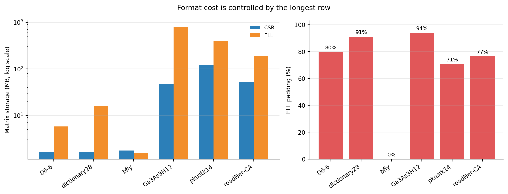

**Figure 1.** Matrix storage and ELL padding computed from the expanded CSR matrices. The storage axis is logarithmic.

`bfly` has exactly four entries per row, so ELL has **no padding** and even saves the CSR row-pointer array. `Ga3As3H12` has a longest row of 1,622 entries against an average of 97.33: ELL stores 99.51 million slots for 5.97 million true nonzeros. This creates about 796 MB of ELL matrix storage and 94% padding. `dictionary28` similarly pays almost ten times CSR's storage. At the main eight-thread configuration, median ELL conversion setup time was **99.55 ms** for `Ga3As3H12` and **69.92 ms** for `pkustk14`, and these costs are reported separately from kernel time and would matter if SpMV were called only a few times.

## 3. Thread scaling

To calculate speedup, $S(t)=T_1/T_t$ and $E(t)=S(t)/t$, where $T_1$ is the one-thread time of the **same** kernel. SIMD speedup is scalar OpenMP time divided by the matching SIMD kernel time at the **same thread count and partition**.

Figure 2 shows strong scaling at a fixed problem size. Figure 3 gives efficiency at every required thread count, and Figure 4 highlights 8 and 16-thread efficiency. The dashed ideal line is $S=t$ or $E=1$. Each curve uses its own one-thread kernel measurement.

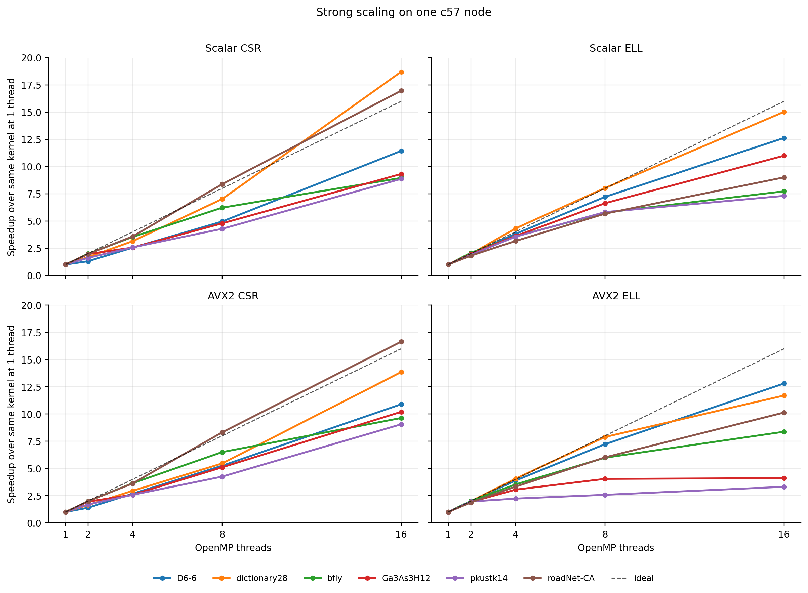

**Figure 2.** Strong scaling against each kernel's own one-thread median; the dashed line is ideal linear scaling.

Scaling is generally strongest from 1 through 8 threads and becomes less consistent at 16 threads. CSR benefits when each thread receives enough nonzeros and the row assignment is reasonably balanced. ELL benefits from its regular slot traversal when padding is modest, but large padded working sets increase memory traffic and flatten the curves. Small cases such as `bfly` reach only tens of microseconds per iteration at eight threads, leaving little work with which to amortize OpenMP overhead. Thus, increasing the thread count can still reduce absolute time while producing progressively less than ideal speedup.

Three curves cross the ideal line at 16 threads: scalar CSR on `dictionary28` has $S(16)=18.71$, scalar CSR on `roadNet-CA` has $S(16)=16.98$, and AVX2 CSR on `roadNet-CA` has $S(16)=16.65$. These are **measured speedups relative to their one-thread runs**, not evidence that 16 cores provide more than 16-fold arithmetic capacity. Changed cache residency, memory-level parallelism, placement, or frequency are plausible contributors. This experiment did not isolate them. This could be treated as the exact amount above ideal as a measured **anomaly** rather than an architectural claim.

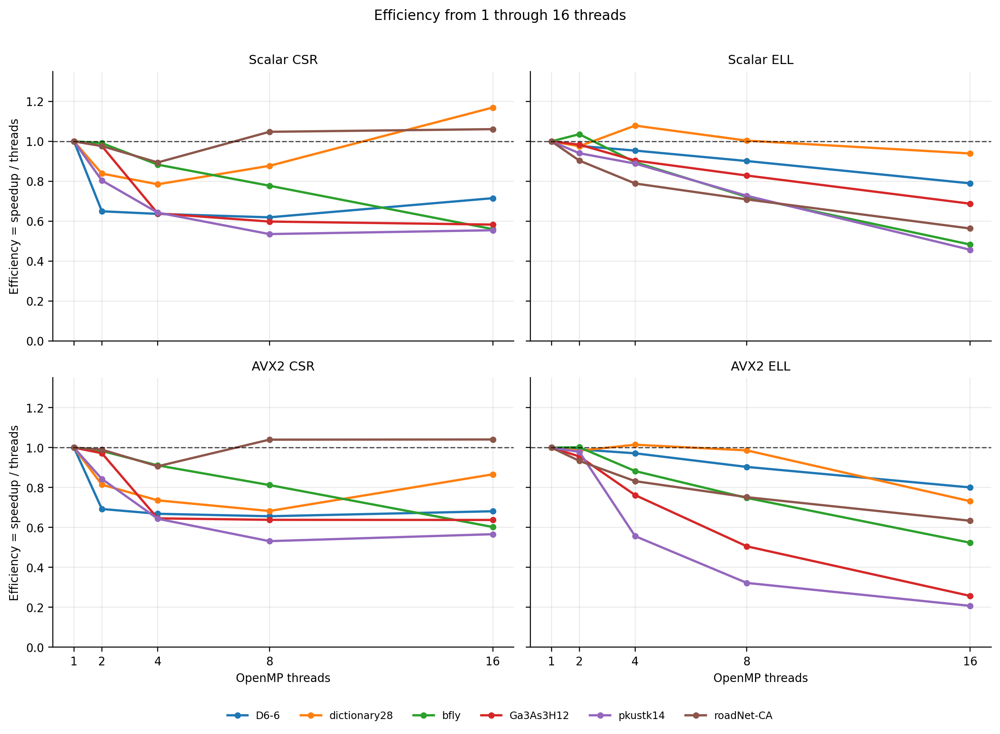

**Figure 3.** Efficiency $E(t)=S(t)/t$ for all required thread counts (the dashed line marks ideal efficiency).

Efficiency expresses how much of ideal linear scaling is retained: $E=1$ means that doubling the threads halves the time, whereas $E<1$ means that overhead, imbalance, or memory-system effects consume part of the added capacity. The declining curves show that these costs generally grow with thread count. CSR efficiency is especially sensitive to unequal nonzero counts per thread, while ELL can have equal slot work yet lose efficiency through padding and shared-memory traffic. `bfly` illustrates the latter case: its ELL work is balanced, but its small, four-slot rows provide too little work per thread to maintain high efficiency.

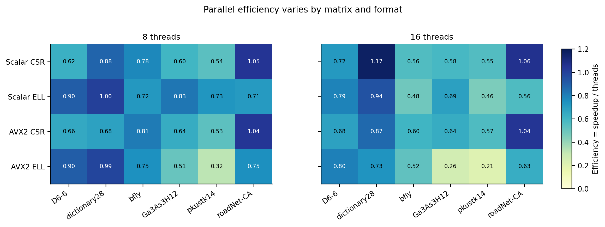\*

**Figure 4.** Efficiency at 8 and 16 threads, numerically for each matrix and kernel.

**Eight-thread median time (ms)**

| Matrix       | Scalar CSR | Scalar ELL | AVX2 CSR | AVX2 ELL |
| ------------ | ---------: | ---------: | -------: | -------: |
| D6-6         |      0.096 |      0.060 |    0.111 |    0.072 |
| dictionary28 |      0.083 |      0.187 |    0.124 |    0.181 |
| bfly         |      0.032 |      0.028 |    0.031 |    0.029 |
| Ga3As3H12    |      1.094 |     51.281 |    0.870 |   32.018 |
| pkustk14     |      2.748 |     15.795 |    2.613 |   18.026 |
| roadNet-CA   |      1.882 |      5.020 |    2.100 |    5.239 |

This table reports **absolute kernel time** at the assignment's main configuration of one node and eight OpenMP threads. Lower values are better. Comparisons within a row show which storage format and implementation completes that matrix fastest under the same thread count. For example, AVX2 CSR is fastest on `Ga3As3H12`, whereas scalar ELL is slightly faster than scalar CSR on `D6-6` and `bfly`. The magnitude also shows how much work remains after parallelization: `bfly` completes in only about 0.03 ms, while the heavily padded `Ga3As3H12` ELL kernels require tens of milliseconds.

**Sixteen-thread speedup, $S(16)=T_1/T_{16}$**

| Matrix       | Scalar CSR | Scalar ELL | AVX2 CSR | AVX2 ELL |
| ------------ | ---------: | ---------: | -------: | -------: |
| D6-6         |     11.44× |     12.63× |   10.90× |   12.81× |
| dictionary28 |     18.71× |     15.03× |   13.86× |   11.70× |
| bfly         |      8.96× |      7.73× |    9.64× |    8.38× |
| Ga3As3H12    |      9.32× |     11.00× |   10.20× |    4.11× |
| pkustk14     |      8.87× |      7.31× |    9.06× |    3.31× |
| roadNet-CA   |     16.98× |      9.01× |   16.65× |   10.14× |

This table reports **strong-scaling speedup** at 16 threads, calculated separately for each kernel as its one-thread time divided by its 16-thread time. A value of 16× represents ideal linear scaling from one to 16 threads: smaller values show that overhead, imbalance, and shared-memory traffic consume part of the additional parallel capacity. Thus, `Ga3As3H12` AVX2 ELL achieves only 4.11× speedup, while scalar and AVX2 CSR on `roadNet-CA` reach measured speedups slightly above 16×. These speedups describe how each implementation scales from its own baseline, independently of its absolute elapsed time.

**Sixteen-thread efficiency, $E(16)=S(16)/16$**

| Matrix       | Scalar CSR | Scalar ELL | AVX2 CSR | AVX2 ELL |
| ------------ | ---------: | ---------: | -------: | -------: |
| D6-6         |       0.72 |       0.79 |     0.68 |     0.80 |
| dictionary28 |       1.17 |       0.94 |     0.87 |     0.73 |
| bfly         |       0.56 |       0.48 |     0.60 |     0.52 |
| Ga3As3H12    |       0.58 |       0.69 |     0.64 |     0.26 |
| pkustk14     |       0.55 |       0.46 |     0.57 |     0.21 |
| roadNet-CA   |       1.06 |       0.56 |     1.04 |     0.63 |

This table reports the fraction of ideal 16-thread scaling retained by each kernel. An efficiency of 1.00 represents ideal scaling, while values below 1.00 show lost parallel efficiency. Values slightly above 1.00 correspond to the superlinear speedup anomalies discussed after Figure 2 rather than more than 100% physical utilization.

The benefit of using more OpenMP threads, thereby using more physical cores within the same node, depends on both the matrix and its storage format. The **Sixteen-thread efficiency** table shows scalar CSR efficiencies of 0.58 on `Ga3As3H12` and 0.55 on `pkustk14`, leaving static row assignment with unequal work, and memory access is irregular. It also shows that scalar ELL on `bfly` reaches only 0.48 efficiency even though its work is balanced: this small matrix and short four-slot rows leave little work per thread, so overhead and shared-memory limits matter. For AVX2 ELL on `Ga3As3H12`, the **Eight-thread median time** table reports 32.02 ms, while its measured 16-thread time is 31.50 ms, so adding eight threads produces almost no further improvement. Its 0.26 efficiency in the **Sixteen-thread efficiency** table is consistent with bandwidth and gather costs on its large padded working set.

## 4. Load balancing and schedules

Each thread owns complete rows. In CSR, the cost of a row depends on its number of true nonzeros, so thread $t$'s work is $W_t=\sum_{i\in R_t}\mathrm{nnz}(i)$, where $R_t$ is the set of rows assigned to that thread. Giving every thread the same number of rows can therefore leave one thread with much more work than another. The measurement $I=\max_t W_t/\operatorname{mean}_t W_t$: $I=1$ means equal work, while $I=1.5$ means the busiest thread has 50% more work than the average. Dynamic scheduling attempts to balance CSR by assigning row chunks during each SpMV. The fixed nonzero partition instead calculates contiguous row boundaries once during setup so that each range contains approximately the same number of true nonzeros.

ELL has a different cost model. Every ELL row processes exactly $K$ stored slots, including padding, so thread $t$'s work is $W_t=|R_t|K$. Equal row counts therefore give threads nearly equal ELL work. The `--partition=nnz` option, however, calculates its row boundaries from the true row lengths in the original CSR input before the ELL kernel runs. Equalizing those true nonzero counts can produce unequal row counts. Because ELL performs $K$ operations for every assigned row, those unequal row counts can make the ELL execution less balanced.

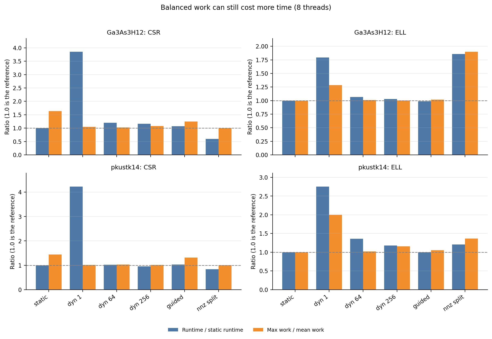

**Figure 5.** Each policy has two bars. Blue is runtime divided by static-row runtime, and values below 1 are faster than static. Orange is maximum thread work divided by mean thread work, and values near 1 are better balanced. The gray dashed line marks 1.0 for both ratios. CSR counts true nonzeros as work, while ELL counts all stored slots, including padding.

| Matrix / kernel | Policy           |  Median ms |  Max work/thread | Mean work/thread |   Max/mean |
| --------------- | ---------------- | ---------: | ---------------: | ---------------: | ---------: |
| Ga3As3H12 CSR   | static rows      |      1.094 |    1,224,095 nnz |      746,368 nnz |     1.640× |
| Ga3As3H12 CSR   | dynamic,1 rows   |      4.214 |      784,213 nnz |      746,368 nnz |     1.051× |
| Ga3As3H12 CSR   | dynamic,64 rows  |      1.312 |      765,866 nnz |      746,368 nnz |     1.026× |
| Ga3As3H12 CSR   | dynamic,256 rows |      1.275 |      802,559 nnz |      746,368 nnz |     1.075× |
| Ga3As3H12 CSR   | guided rows      |      1.170 |      928,061 nnz |      746,368 nnz |     1.243× |
| Ga3As3H12 CSR   | fixed nnz split  |  **0.656** |      747,168 nnz |      746,368 nnz | **1.001×** |
| pkustk14 CSR    | static rows      |      2.748 |    2,673,639 nnz |    1,854,563 nnz |     1.442× |
| pkustk14 CSR    | dynamic,1 rows   |     11.638 |    1,880,817 nnz |    1,854,563 nnz |     1.014× |
| pkustk14 CSR    | dynamic,64 rows  |      2.798 |    1,915,741 nnz |    1,854,563 nnz |     1.033× |
| pkustk14 CSR    | dynamic,256 rows |      2.612 |    1,880,920 nnz |    1,854,563 nnz |     1.014× |
| pkustk14 CSR    | guided rows      |      2.826 |    2,435,177 nnz |    1,854,563 nnz |     1.313× |
| pkustk14 CSR    | fixed nnz split  |  **2.293** |    1,854,724 nnz |    1,854,563 nnz | **1.000×** |
| Ga3As3H12 ELL   | static rows      | **51.281** | 12,439,118 slots | 12,438,509 slots | **1.000×** |
| Ga3As3H12 ELL   | fixed nnz split  |     95.239 | 23,611,454 slots | 12,438,509 slots |     1.898× |
| pkustk14 ELL    | static rows      | **15.795** |  6,324,003 slots |  6,323,919 slots | **1.000×** |
| pkustk14 ELL    | fixed nnz split  |     19.087 |  8,638,020 slots |  6,323,919 slots |     1.366× |

The most instructive result is `dynamic,1`: on `Ga3As3H12`, CSR imbalance falls from 1.640× to 1.051×, yet runtime rises from 1.094 to 4.214 ms (3.85× slower). On `pkustk14`, imbalance falls from 1.442× to 1.014× while runtime rises from 2.748 to 11.638 ms (4.23× slower). Per-row scheduling overhead and reduced locality plausibly outweigh time saved by leveling work; the measurements establish the trade-off, while separate profiling would be needed to apportion the causes. Larger chunks reduce that overhead but may allow more imbalance. Guided scheduling is close to static on these two CSR cases; it does not outperform the fixed nonzero split. For ELL, static row scheduling is already balanced by slots, and the nonzero split is counterproductive.

A supplemental job completed paired static-row and fixed-nonzero measurements for the other four matrices on c57. It used eight OpenMP threads, three trials per case, and the same scalar-source hashes as job 286323. Because both partitions were measured in the same job on the same node, the time ratios below directly compare the partitioning methods.

| Matrix       | CSR static rows: ms / imbalance | CSR fixed nnz: ms / imbalance | Fixed/static time | Fixed-nnz node |
| ------------ | ------------------------------: | ----------------------------: | ----------------: | -------------- |
| D6-6         |                  0.097 / 1.909× |                0.114 / 1.000× |             1.17× | c57            |
| dictionary28 |                  0.085 / 2.310× |                0.140 / 1.000× |             1.64× | c57            |
| bfly         |                  0.032 / 1.000× |                0.030 / 1.000× |             0.96× | c57            |
| Ga3As3H12    |                  1.094 / 1.640× |                0.656 / 1.001× |         **0.60×** | c57            |
| pkustk14     |                  2.748 / 1.442× |                2.293 / 1.000× |         **0.83×** | c57            |
| roadNet-CA   |                  1.888 / 1.047× |                1.857 / 1.000× |             0.98× | c57            |

The fixed split reduces CSR imbalance to at most 1.001× on every matrix. It clearly improves the two required high-variance cases measured within c57, while `bfly` and `roadNet-CA` have little imbalance to remove. In the supplemental results, balancing `D6-6` and `dictionary28` does not improve elapsed time, reinforcing that balanced nonzero counts alone do not guarantee speed. For ELL, the fixed split remains inappropriate: its slot-work imbalance becomes 4.330× on `D6-6`, 2.805× on `dictionary28`, and 1.030× on `roadNet-CA`, and `bfly` is unchanged because all rows have the same length.

**Load-balancing takeaway:**

The partitioning strategy should match the work performed by the storage format. For CSR on the two required high-variance matrices, the fixed nonzero partition is the best measured choice: it reduces imbalance from 1.640× to 1.001× on `Ga3As3H12` and from 1.442× to 1.000× on `pkustk14`, while reducing runtime by 40% and 17%, respectively. It calculates the row boundaries once during setup, so it avoids making scheduling decisions inside the timed SpMV kernel.

Dynamic scheduling shows why balance cannot be judged separately from elapsed time. A one-row chunk reduces CSR imbalance to 1.051× on `Ga3As3H12` and 1.014× on `pkustk14`, but makes the kernels 3.85× and 4.23× slower than static scheduling. Frequent runtime scheduling and less predictable row access plausibly cost more than the reduction in idle time saves. Larger chunks reduce this overhead but provide no consistent advantage over the fixed nonzero partition.

For ELL, static row scheduling is the appropriate choice. Every row executes $K$ slots, so equal row counts already produce approximately equal slot work. A partition based on true nonzeros instead gives threads unequal numbers of ELL rows: on `Ga3As3H12` it raises imbalance from 1.000× to 1.898× and makes execution 1.86× slower, while on `pkustk14` it raises imbalance from 1.000× to 1.366× and makes execution 1.21× slower. The general result is that **CSR benefits from a setup-time nonzero partition when row lengths vary, ELL benefits from a static equal-row partition, and every balancing decision must be checked against runtime as well as its imbalance ratio.**

## 5. CSR versus ELL across schedules

Figure 6 compares median scalar ELL time with median scalar CSR time at eight threads under static, dynamic with chunk 64, and guided row schedules. Ratios below one favor ELL. Figure 7 relates the static ratio to padding.

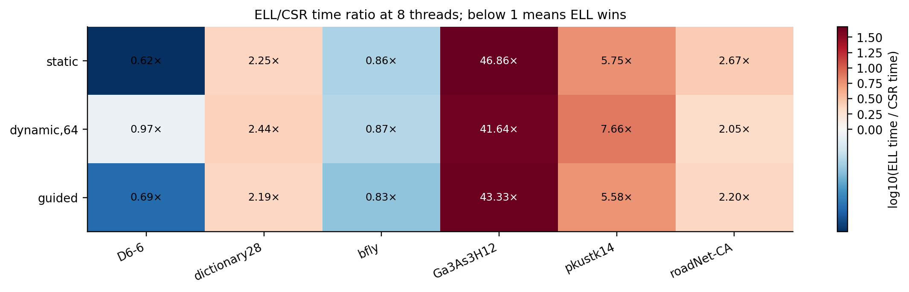

**Figure 6.** ELL/CSR elapsed-time ratio across the six matrices and three row schedules at eight threads.

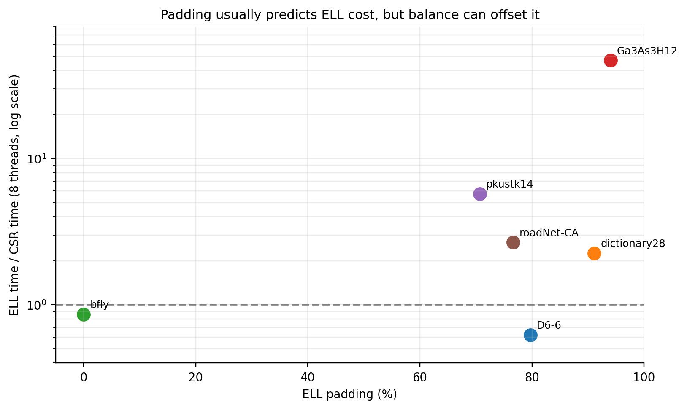

**Figure 7.** ELL padding versus the static-schedule ELL/CSR time ratio. `D6-6` is the instructive exception to a padding-only explanation.

Under the main **static** schedule, ELL wins on `D6-6` (0.62× CSR time) and `bfly` (0.86×). `bfly`'s perfectly uniform four-entry rows give ELL regular access with no padding. `D6-6` is a revealing exception: it has 79.7% padding, while the CSR static row split has 1.91× nonzero-work imbalance and ELL's slot work is nearly equal. ELL's regular access and balanced slot work plausibly help it overcome the extra slots. The paired c57 measurements show that the fixed split makes D6-6 CSR's nonzero work exactly balanced but increases its median time from 0.097 to 0.114 ms. This establishes that removing the measured work imbalance alone does not make CSR faster and therefore does not explain ELL's win by itself. Under `dynamic,64` on c57, both formats slow and the ELL/CSR ratio moves to 0.97×, demonstrating that scheduling overhead can dominate the balance improvement.

CSR wins on `dictionary28`, `Ga3As3H12`, `pkustk14`, and `roadNet-CA` under **all three schedules tested**. The corresponding static ELL/CSR time ratios are 2.25×, 46.86×, 5.75×, and 2.67×. Their ELL padding is 91.1%, 94.0%, 70.7%, and 76.6%. In particular, the 796 MB ELL representation of `Ga3As3H12` makes the regular layout a poor trade: it still reads the padded positions on every multiply. On `roadNet-CA`, CSR's sparse row lengths keep storage much smaller, while its static work imbalance is already low (about 1.05×), leaving little balancing benefit for ELL.

## 6. SIMD outcomes

SIMD speedup compares scalar and AVX2 versions of the **same format** at equal thread counts. Values below one mean the SIMD version was slower. The fixed-width ELL layout supports contiguous value and index loads for eight rows, while CSR vectors within one row and pays an eight-lane reduction. Both formats still gather `x` at irregular column indices.

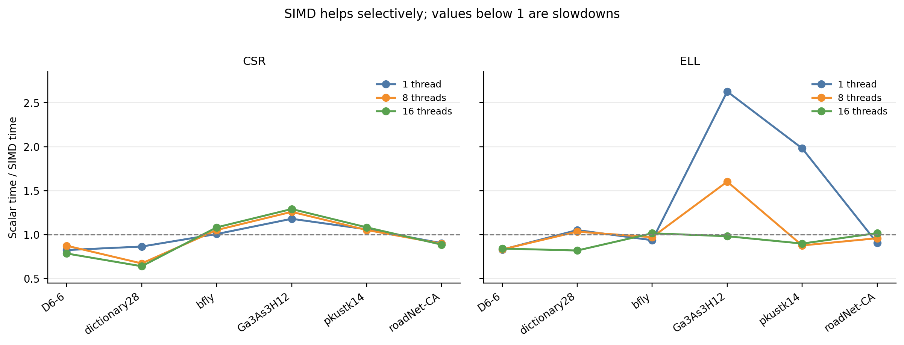

**Figure 8.** Scalar/SIMD time ratio at equal thread counts. Points below the dashed line indicate a SIMD slowdown.

| Matrix       | CSR SIMD speedup, 8t | ELL SIMD speedup, 8t | Main observation                                                      |
| ------------ | -------------------: | -------------------: | --------------------------------------------------------------------- |
| D6-6         |                0.87× |                0.83× | Rows are too short for useful CSR vectors, ELL work is already small. |
| dictionary28 |                0.67× |                1.03× | CSR lane setup/reduction costs more than its short rows repay.        |
| bfly         |                1.05× |                0.97× | Four entries per row, neither kernel benefits materially.             |
| Ga3As3H12    |            **1.26×** |            **1.60×** | Longer rows create useful vector work, despite large ELL padding.     |
| pkustk14     |                1.05× |            **0.88×** | ELL vectorization loses at eight threads despite a one-thread gain.   |
| roadNet-CA   |                0.90× |                0.96× | Short irregular rows and gathers limit benefit.                       |

At one thread, ELL SIMD is 2.63× faster than scalar ELL on `Ga3As3H12` and 1.98× faster on `pkustk14`. At eight threads the gains shrink to 1.60× and 0.88×; at 16 threads they are 0.98× and 0.90×. The declining benefit with more threads is consistent with a shared memory-system limit. CSR SIMD is 1.26× faster on `Ga3As3H12` at eight threads but 0.67× as fast on `dictionary28`, whose average row contains only 3.38 entries, fewer than one eight-wide vector. The AVX2 CSR reduction also changes summation order, so its small nonzero numerical error is expected. FMA changes rounding in ELL, and all errors remain well within tolerance.

## 7. Bandwidth and combined roofline

The roofline analysis asks whether the measured SpMV kernels are limited more strongly by arithmetic throughput or by memory movement. Answering that question requires the useful work, the modeled traffic, the resulting arithmetic intensity, and the measured execution time.

One SpMV performs one multiplication and one addition for each true matrix nonzero. Its useful work is therefore

$$F=2\,\mathrm{nnz}\quad\text{FLOPs}.$$

The harness uses a nominal traffic model rather than hardware-counter measurements. For CSR, each nonzero contributes a 4-byte value, a 4-byte column index, and one modeled 4-byte access to `x`. The row pointer and output vector contribute approximately 8 bytes per row. The resulting traffic estimate is

$$B_{CSR}=12\,\mathrm{nnz}+8m\quad\text{bytes}.$$

ELL stores $mK$ slots, including padding. Each slot contributes a value, column index, and modeled `x` access, while the output contributes 4 bytes per row:

$$B_{ELL}=12mK+4m\quad\text{bytes}.$$

Arithmetic intensity measures useful work per modeled byte, while effective bandwidth measures modeled bytes processed per second:

$$\beta_{eff}=\frac{B}{T},\qquad I=\frac{F}{B}.$$

Measured computational performance is useful work divided by execution time:

$$P=\frac{F}{T}\quad\text{FLOP/s}.$$

Each roofline point is placed at $(I,P)$: arithmetic intensity on the horizontal axis and achieved GFLOP/s on the vertical axis.

This model charges every modeled `x` access even when a cache supplies the value, so $\beta_{eff}$ is an effective traffic rate rather than a direct measurement of DRAM traffic. For CSR matrices with many nonzeros per row, the row term becomes small and the intensity approaches $2/12=0.167$ flop/byte. ELL padding increases $mK$ without increasing useful work, reducing its intensity. For example, `Ga3As3H12` has $I_{CSR}=0.166$ flop/byte but only $I_{ELL}=0.010$ flop/byte.

Sustainable memory bandwidth was measured separately with STREAM on the same c57 node. The benchmark used 16 OpenMP threads and three arrays of 610.4 MiB each, for an aggregate working set of approximately 1.8 GiB, and passed its validation check. The best Triad result was 100.45 GB/s. The EPYC 7302P specification gives a theoretical per-socket maximum of 204.8 GB/s, so the measured STREAM rate is 49.0% of the theoretical value. [STREAM benchmark rules](https://www.cs.virginia.edu/stream/ref.html), [AMD EPYC 7302P specifications](https://www.amd.com/en/support/downloads/drivers.html/processors/epyc/epyc-7002-series/amd-epyc-7302p.html).

For a memory-bound kernel, the bandwidth roof is $P_{mem}=\beta I$. At the commonly quoted SpMV intensity of 0.17 flop/byte, the measured STREAM bandwidth gives

$$P_{mem}=100.45\times0.17=17.08\ \mathrm{GFLOP/s},$$

whereas the theoretical bandwidth gives

$$P_{mem}=204.8\times0.17=34.82\ \mathrm{GFLOP/s}.$$

These calculations define two bandwidth-reference lines. The STREAM line uses measured sustainable bandwidth on c57, and the 204.8 GB/s line uses the processor's theoretical memory-interface limit.

The processor's theoretical arithmetic ceiling provides the other part of the roofline. With 16 cores, the node-reported 3.0 GHz maximum, eight FP32 values per AVX2 vector, two vector FMAs per cycle, and two FLOPs per FMA, the ceiling is

$$P_{compute}=(16)(3.0)(8)(2)(2)=1536\ \mathrm{GFLOP/s}.$$

Combining the compute ceiling with theoretical memory bandwidth gives

$$P(I)=\min\left(1536,\ 204.8I\right)\ \mathrm{GFLOP/s}.$$

The memory and compute bounds meet at the ridge point

$$I^*=\frac{1536}{204.8}=7.50\ \mathrm{FLOP/byte}.$$

The largest CSR intensity in these experiments is only 0.166 FLOP/byte, approximately 45 times below the ridge. Every measured kernel therefore lies on the low-intensity, memory-bound side of the roofline. The plot below restricts its axes to this region so that the matrix and kernel points remain distinguishable. The 1536 GFLOP/s compute ceiling and the ridge at 7.50 FLOP/byte lie outside the displayed range.

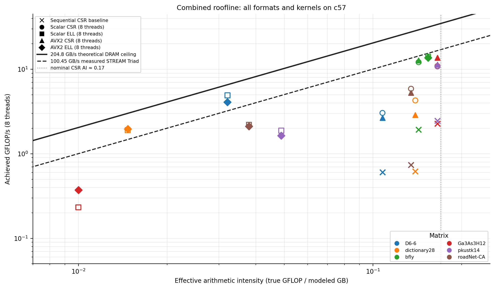

**Figure 9.** Combined roofline for sequential CSR and the eight-thread scalar and AVX2 kernels. Matrix color and marker shape identify each measurement. The two sloped lines show measured STREAM bandwidth and theoretical memory bandwidth; the view is restricted to the low-intensity region occupied by SpMV.

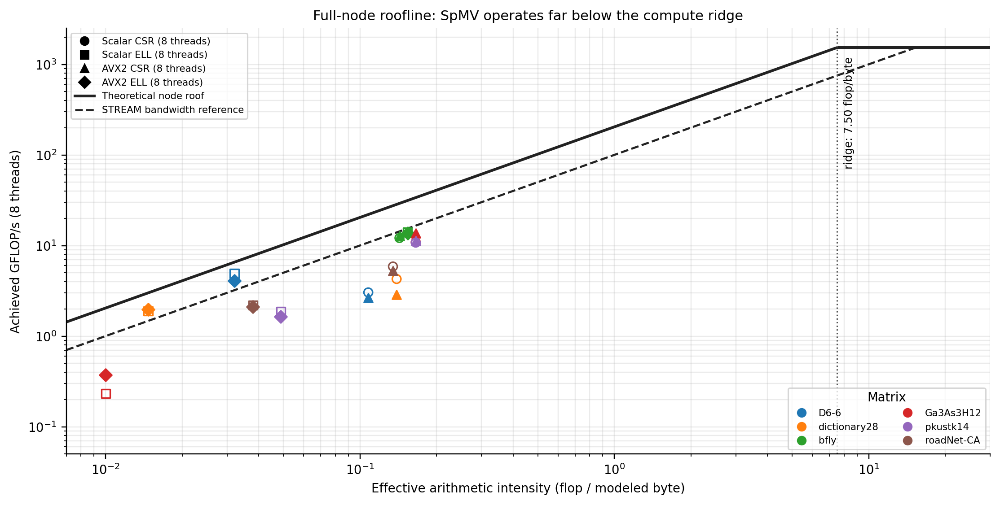

**Figure 9a.** Full-node roofline showing the 1536 GFLOP/s theoretical compute ceiling and the ridge at 7.50 FLOP/byte. It contains the same eight-thread kernel points as Figure 9 but extends the axes to the complete architectural range.

The two roofline figures answer complementary questions. Figure 9 enlarges the low-intensity region so differences among matrices, formats, and kernels remain visible. Figure 9a shows where that entire region lies relative to the processor's compute ceiling and ridge point. The measured points consequently cluster in its lower-left corner; that compression is the evidence that their arithmetic intensities are far inside the **memory-bound** region.

| Matrix       | CSR intensity | ELL intensity | Scalar CSR 8t GFLOP/s | Scalar CSR effective GB/s | Effective / STREAM |
| ------------ | ------------: | ------------: | --------------------: | ------------------------: | -----------------: |
| D6-6         |         0.108 |         0.032 |                  3.04 |                     28.27 |                28% |
| dictionary28 |         0.139 |         0.015 |                  4.28 |                     30.77 |                31% |
| bfly         |         0.143 |         0.154 |                 12.14 |                     84.96 |                85% |
| Ga3As3H12    |         0.166 |         0.010 |                 10.91 |                     65.92 |                66% |
| pkustk14     |         0.166 |         0.049 |                 10.80 |                     65.22 |                65% |
| roadNet-CA   |         0.135 |         0.038 |                  5.88 |                     43.67 |                43% |

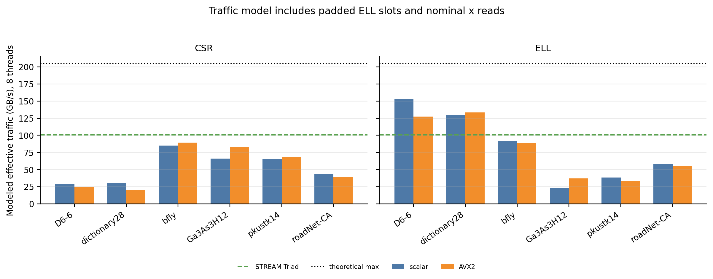

**Figure 10.** Effective eight-thread traffic rate from the harness's byte model, with measured STREAM Triad and theoretical processor limits shown separately.

The combined plot includes one sequential CSR baseline point per matrix and 8-thread scalar OpenMP and SIMD points for both formats. The lines show bandwidth times effective intensity; they are **reference slopes**, not measured per-kernel DRAM traffic. For example, scalar ELL on `D6-6` reports 153.1 GB/s of _modeled_ traffic, greater than STREAM's 100.45 GB/s Triad. This is not a physical DRAM measurement above STREAM: the harness charges every `x` access and padded slot as if it were a distinct memory transfer, while cache hits can satisfy many accesses. The arithmetic intensity and the achieved-bandwidth percentages must be read with that modeling limitation. Conversely, low effective GB/s on large ELL matrices reflects padding, gathers, and access efficiency; it is not proof of a single isolated hardware bottleneck.

The core conclusion is nevertheless robust. Useful SpMV work has low arithmetic intensity, and every added thread or FMA lane shares the node's finite memory bandwidth. `bfly` reaches 85% of STREAM Triad in scalar CSR's effective byte model yet gains little from AVX2 at eight threads; its four-entry rows do not expose enough vector work. `Ga3As3H12` gains from CSR SIMD but is dominated by ELL padding, whose useful intensity is only 0.010 flop/byte. `pkustk14` ELL accelerates with AVX2 at one thread but loses at eight, showing that vector arithmetic improvements need not survive when shared-memory traffic becomes the limiting resource.

## 8. Observed anomalies

The following results depart from the usual expectation that more threads, better work balance, or SIMD execution should consistently reduce runtime:

1. **Three CSR measurements scale beyond the ideal 16-thread line.** Scalar CSR reaches $S(16)=18.71$ on `dictionary28` and $S(16)=16.98$ on `roadNet-CA`; AVX2 CSR reaches $S(16)=16.65$ on `roadNet-CA`. These values use each kernel's measured one-thread time as the baseline. Cache residency, memory-level parallelism, processor frequency, and timing variability can make the measured ratio exceed 16, especially for short kernels. The experiment did not isolate these effects, so the results are treated as measurement anomalies rather than evidence of more than 16-fold computational capacity.

2. **ELL beats CSR on `D6-6` despite 79.7% padding.** The extra ELL slots would normally be expected to hurt performance. However, static CSR has a 1.91× nonzero-work imbalance, whereas ELL assigns almost equal slot work and uses a regular column-major access pattern. These benefits plausibly offset the padded operations in this case.

3. **Equalizing CSR nonzeros does not always reduce runtime.** In paired c57 measurements, the fixed-nonzero partition lowers the measured imbalance to approximately 1.0 on `D6-6` and `dictionary28`, yet their runtimes increase by 17% and 64%, respectively. This shows that equal work counts alone do not guarantee lower runtime; the changed row boundaries and memory-access behavior can outweigh the reduction in idle time.

4. **SIMD sometimes slows the kernel.** At eight threads, CSR SIMD speedup is only 0.67× on `dictionary28`, and ELL SIMD speedup is 0.88× on `pkustk14`. Short rows leave too little full-width vector work in CSR, while gathers, reductions, padding, and shared-memory traffic can outweigh the reduction in arithmetic instructions in either format.

5. **AVX2 ELL on `Ga3As3H12` gains almost nothing from eight additional threads.** Runtime changes only from 32.02 ms at eight threads to 31.50 ms at 16 threads, producing a 16-thread efficiency of 0.26. Its large padded representation, irregular gathers, and shared memory traffic are consistent with this early scaling limit.

6. **Balanced ELL work does not ensure strong scaling on `bfly`.** Every row contains four entries, so ELL has no padding and nearly uniform work, but its scalar 16-thread efficiency is only 0.48. The matrix supplies little work per thread, making parallel overhead and shared-resource limits visible even without load imbalance.

## 9. Conclusions and limits

1. **Format selection is matrix dependent.** ELL wins only when its regular access and balance offset padding (`D6-6`) or when rows are uniformly short (`bfly`). High max/average row-length ratios make CSR far more compact and usually faster.
2. **Balance is not equivalent to speed.** Nonzero partitioning makes CSR work nearly equal and improves both required high-variance matrices, zand `dynamic,1` also balances work but is several times slower because its extra coordination and access pattern cost more than the saved idle time.
3. **SIMD has selective value.** Long CSR rows and eight-row ELL blocks can benefit. Short rows, horizontal reductions, gathers, padding, and shared bandwidth erase or reverse the gain on other matrices.
4. **The byte model is useful but not a DRAM counter.** The roofline uses the assignment's reported effective traffic and separately labels STREAM's measured sustainable bandwidth and AMD's theoretical ceiling. Points above the STREAM slope are possible under cache reuse and do not contradict the physical limit.

Three trials per case support median comparisons but do not establish tight confidence intervals. Some close rankings, especially `bfly` and minor schedule differences, should be interpreted cautiously. The sequential baseline has one trial per matrix. This experiment does not measure hardware cache misses or DRAM traffic with performance counters, so the locality and bandwidth explanations are informed inferences from layout, work distribution, the harness's byte model, and timing rather than direct counter measurements. The run used one node and one CPU generation; a different node, placement policy, or memory configuration may change absolute timings.

### Reproducibility

The submitted archive follows the assignment requirements and contains only the four kernel source files. The measurements summarized here were collected in ARC jobs **286323** (primary SpMV sweep on c57), **289766** (paired supplemental partition runs on c57), and **286330** (STREAM on c57). The primary sweep produced 360 scaling and 108 scheduling measurements, and the supplemental sweep added 48 paired partition measurements. All 516 SpMV runs reported `PASS`, and the maximum relative L2 error was $4.744\times10^{-7}$.

<!-- The raw CSV files, baseline outputs, build logs, hardware records, and recorded SHA-256 values are retained locally for verification but are not included in the submission archive. Before packaging, the submitted source files were checked against the hashes recorded during the measurement jobs, and the figures and tables were regenerated from the retained raw measurements. -->
